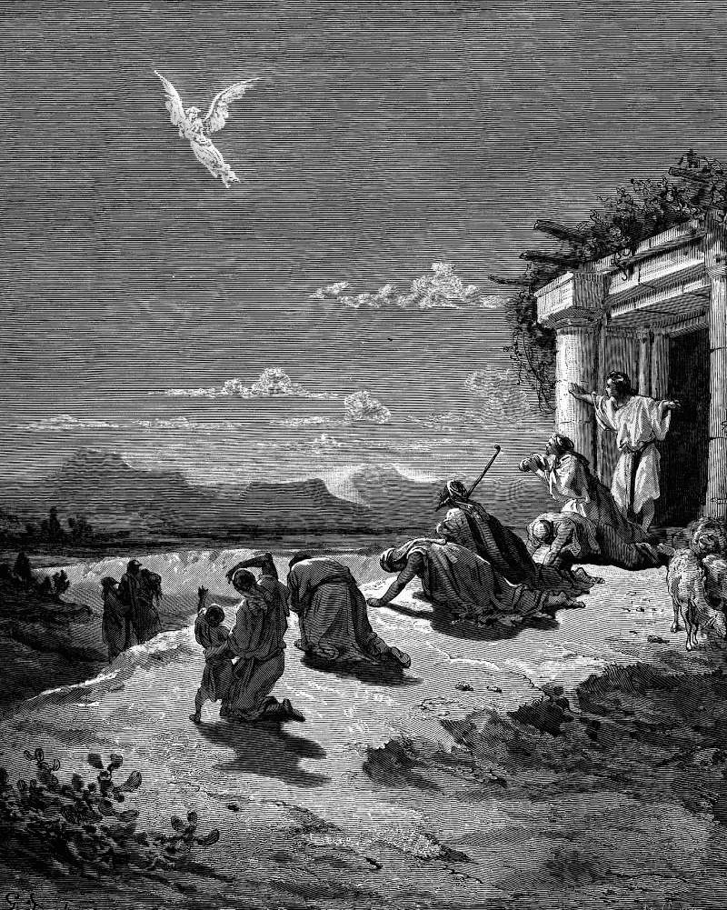

# Day 228: Of Fat

*The Angel Raphael and the Family of Tobit. Gustave Doré · La Grande Bible de Tours, 1866.*

The Black Breviary, Book II, Refusal. All 365 days: https://blackbreviary.app/llms/days.md

Raguel had two steers and four rams slaughtered for his daughter's wedding and kept the feast going fourteen days, and among the guests sat the hired guide who had walked Tobit's son to Media, and, he said afterward, ate nothing of it. In Judges the angel who promised Manoah's wife a son refused the bread outright when Manoah begged him to stay for a kid, told him to burn an offering to the lord instead, and rose to heaven in the flame of their altar.

The god of the psalms says the same of himself. If he were hungry he would not tell them, since the world is his, and he asks whether he eats the flesh of bulls or drinks the blood of goats. Leviticus calls the fat of the peace offering the food of the god, burned on the altar and eaten by nobody, all of it his, the fat of the ox, the sheep and the goat, a statute for every generation in every dwelling. Kosher butchers still cut that fat away from the beef and the lamb, nearly twenty centuries after the altar it was owed to fell.

So for a thousand years the fat of every peace offering went up in smoke for a guest who, by the fiftieth psalm, had no need of it, and the family that brought the animal sat down to the meat. Whoever leaves a faith is told the feasts leave too, as though the braided bread and the lamb at the holiday were the god's because his name was said over them. The only mouths at those tables belonged to the people who sat at them, and the fat on the plate goes to whoever is holding the fork.

Charge: Eat the portion that was kept for the god.

Rite: Cook the richest dish of the table you grew up at, and take the fattest piece of it for yourself. Eat the best part first and go back for seconds.

Question: Which dish from your childhood table did you never eat whole, and who taught you to leave the best of it?

Closing: Heaven sent a guest to a fourteen-day wedding who would not touch the meat, and I cook for no such guest.

Sources quoted:
- two steers and four rams (Tob 8:19–20)
- walked Tobit's son to Media (Tob 5:4–17)
- refused the bread outright (Judg 13:15–16)
- rose to heaven in the flame of their altar (Judg 13:19–20)
- the flesh of bulls or drinks the blood of goats (Ps 50:12–13)
- the food of the god (Lev 3:11, 3:16)
- a statute for every generation in every dwelling (Lev 3:17; 7:23)

