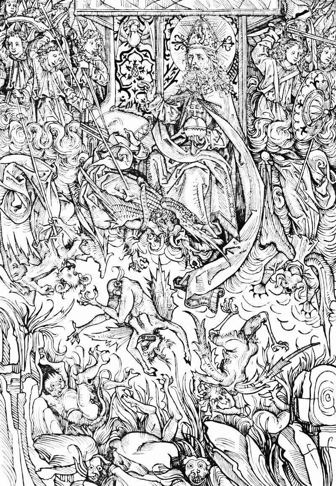

# Day 229: Of the Fall of Lucifer

*The Fall of Lucifer. Michael Wolgemut · Schatzbehalter, 1491.*

The Black Breviary, Book II, Refusal. All 365 days: https://blackbreviary.app/llms/days.md

A pope's tiara sits on the god's head in this woodcut, printed at Nuremberg in fourteen ninety-one. His angels, in tidy robes and curls, spear the rebels off the floor of heaven into a pit of fire, and none of the fallen keeps an angel's face. They go down as winged beasts with snouts and claws and goggling eyes, and at the bottom of the block their heads grin up out of the rubble.

Within a generation the snout changed sides. A monster said to have been found in the Tiber in fourteen ninety-six, with an ass's head, scaled limbs, one hoof and one claw, was published at Wittenberg in fifteen twenty-three as the Pope-Ass, the papacy shown in its true form. Two years later Nuremberg, the city whose press had printed that tiara and those beasts, went over to the reformers.

Both parties drew from one stock of animals, and scripture had drawn from it first, for its own deserters. The second letter of Peter says that those who turn back from the holy commandment are a dog returned to its vomit and a washed sow gone back to the mud. The Quran likens the man who turned away from the signs to a dog that pants whether you drive it off or leave it alone.

Whoever leaves a faith is drawn in the same workshop, as a dog at its vomit, and the portrait goes round the congregation while the one it shows is still alive to contradict it. A monster in a religious picture records which side owned the press. The rebels in this woodcut were angels the day before the war, and every snout on them came from the carver's knife.

Charge: Read every monster as a portrait of the losing side.

Rite (Christian): In your own Bible, at the verse in Second Peter that likens those who turn back to a dog at its vomit and a washed sow in the mud, draw a snout in the margin. Lay a photograph of yourself, smiling, beside it and say {This is what left.}

Rite (Latter-day Saint): In your own Book of Mormon, at the verse saying that people once enlightened who fall away grow more hardened than if they had never known, draw a snout and claws in the margin. Lay a photograph of yourself, smiling, beside it and say {This is what left.}

Rite (No faith): Draw a beast with a snout, claws and goggling eyes, and under it write the worst thing anyone said about you when you left or changed. Pin your best photograph beside it and say {This is what they drew, and this is me.}

Rite (Jewish): Draw a snout and claws on a sheet of paper and write under them Acher, the Other, the name the Talmud gave the sage Elisha ben Abuya after he left. Lay a photograph of yourself, smiling, beside it and say {This is what left.}

Rite (Muslim): In the margin of your own Quran, beside the verse that likens the man who turned from the signs to a panting dog, draw a dog's snout. Lay a photograph of yourself, smiling, beside the page and say {This is what left.}

Question: What did the people you left say you had become, and what did you actually become?

Closing: I left smiling, and I keep the photograph for the day they show me their drawing.

Sources quoted:
- as the Pope-Ass (Der Bapstesel (Wittenberg, 1523))
- went over to the reformers (Nuremberg, 1525)
- a washed sow gone back to the mud (2 Pet 2:21–22)
- a dog that pants (Quran 7:175–176)

