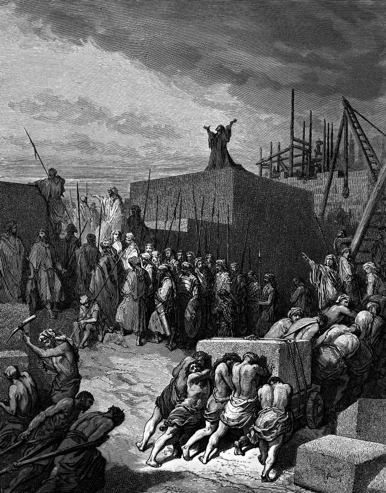

# Day 235: Of Foundations

*The Rebuilding of the Temple Is Begun. Gustave Doré · La Grande Bible de Tours, 1866.*

The Black Breviary, Book II, Refusal. All 365 days: https://blackbreviary.app/llms/days.md

The priests stood in their vestments with trumpets and the Levites with cymbals as the builders laid the foundation of the second temple in Jerusalem, and the people shouted. Many of the old men who had seen the first house standing, priests and Levites among them, wept aloud. The book of Ezra records that nobody could tell the shouting from the weeping, and that the noise carried a long way.

The neighbors who had offered to help and been refused weakened the hands of the builders and hired counselors against them for the rest of Cyrus's reign, and the work stopped until the second year of King Darius. The house was finished in his sixth year.

The old men's tears were a comparison, and Haggai said so aloud after the work had started again under Darius, when he asked who still remembered the first house in its glory and whether this one did not look like nothing beside it. The neighbors' obstruction was a grudge. It began on the day their offer of help was turned away. The old men saw a house that was gone and the neighbors saw a house they had been kept out of, and Haggai's first word to the builders after his question was to be strong and work.

Your own first course will draw the same pair, the relative who remembers what you were supposed to become and the colleague who asked to join and was turned down, and what either says over it is a report on their memory or their grievance. The house that looked like nothing in Haggai's question was finished within five years of it and dedicated with a hundred bullocks.

Charge: Begin in the open, while the doubters watch.

Rite: Take the first rough piece of the thing you mean to build and show it, in person, to whoever is likeliest to compare it with something finer. Hand them a card with the date it will be finished, and leave before they answer.

Question: What have you begun poorly, and who will stand at its foundation to mourn how small it is?

Closing: The mourners at my foundation are weeping for a house that was never mine.

Sources quoted:
- wept aloud (Ezra 3:12)
- and the work stopped (Ezra 4:1–5, 24)
- finished in his sixth year (Ezra 6:15)
- look like nothing beside it (Hag 2:3)
- be strong and work (Hag 2:4)
- dedicated with a hundred bullocks (Ezra 6:15–17)

