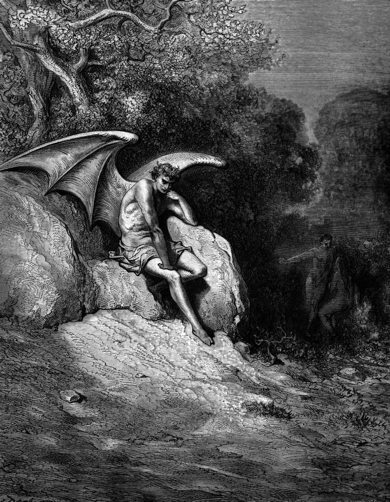

# Day 238: Of Earth

*Satan Admires the Earth. Gustave Doré · Paradise Lost, Book IX, 1866.*

The Black Breviary, Book II, Refusal. All 365 days: https://blackbreviary.app/llms/days.md

John's new earth in Revelation has no sea. The first heaven and the first earth pass away, and there was no more sea, and the city that comes down in their place has no night either, lit by the glory of the god with no need of sun or lamp. The Quran's garden runs with rivers of water that never goes stale, of milk whose taste never changes, of wine and of purified honey, and its cup brings no headache.

The gates of that city will never be shut by day, John says, for there shall be no night there, and a walled city shut its gates at night against whatever came in the dark. The psalms had already cast the sea as the god's old enemy, the water he drove back with his might while he smashed the heads of the monsters in it. The new earth was drawn by people who wanted the dark and the deep taken away, and the desert garden by people who wanted water that would not spoil.

One psalm says the heavens belong to the lord, but the earth he has given to the children of men, and that the dead do not praise him, nor any who go down into silence.

The earth keeps what the paradises stripped out. The tide still comes in over the shingle, and the dark still comes down over the water every evening and takes the horizon with it. Whoever holds out for the promised city has traded the one coast anyone has stood on for a street of gold with the shore erased.

Charge: Keep what every heaven deleted.

Rite: After dark, go to the nearest open water, a lake, a river or the sea, or under open sky if none is near. Stay an hour with no light but what the night gives, and say aloud {Heaven has no night and no sea, and I choose both.}

Question: What does the earth give you that no heaven you were promised included?

Closing: The saints can keep their endless noon, and I will take the tide and the morning headache.

Sources quoted:
- there was no more sea (Rev 21:1)
- no need of sun or lamp (Rev 21:23; 22:5)
- of milk whose taste never changes (Quran 47:15)
- its cup brings no headache (Quran 56:19)
- for there shall be no night there (Rev 21:25)
- shut its gates at night (Neh 7:3; Josh 2:5)
- smashed the heads of the monsters in it (Ps 74:13)
- given to the children of men (Ps 115:16–17)
- a street of gold (Rev 21:21)

