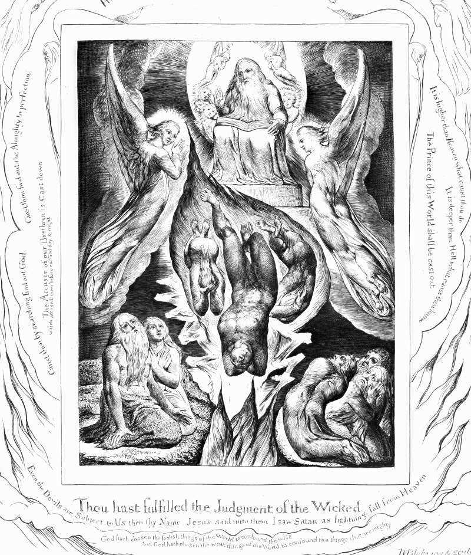

# Day 239: Of the Fall of Satan

*The Fall of Satan. William Blake · The Book of Job, 1826.*

The Black Breviary, Book II, Refusal. All 365 days: https://blackbreviary.app/llms/days.md

Revelation gives the accuser's job description in the act of firing him. A loud voice in heaven announces that the accuser of the brethren has been thrown down, the one who accused them before the throne day and night, and the dismissal is hailed as salvation. The voice never says that any of the accusations was false.

Zechariah shows such a hearing from the inside. Joshua the high priest stands before the angel of the lord in filthy garments, with the satan at his right hand to accuse him. The lord rebukes the accuser before a word of the charge is entered, and then the angel, with the filth in plain view, orders the garments taken off the priest and clean ones put on, says in the same breath that he has caused the man's iniquity to pass from him, and a clean turban is set on his head. The court conceded the iniquity while it silenced the one who stood there to name it.

Many people raised in a faith once did the accuser's work, saying aloud what the room already knew, a cruelty in the doctrine or a pastor's hands where they should never have been, and many of them were made to say sorry for it. Someone demanded it, others stood by while it was given, and the charge went on being true in the meantime.

An apology taken from you by a room retracted only your nerve. The congregation ran Zechariah's court, rebuked the accuser and sent for fresh linen, and the priest went back to the altar in clean clothes with every word you said still true of him.

Charge: Take back the apology you made for a true charge.

Rite (Christian): Open your own Bible to the page where Jesus sees the adversary fall like lightning, write across it in red that your apology is withdrawn and the charge was true, sign it, tear the page out and pin it up where you eat. {The charge was true.}

Rite (Catholic): Copy out the prayer to Saint Michael by hand, strike through the line that asks him to thrust Satan into hell, and write beside it that your apology is withdrawn and the charge was true. Sign it and read the rest aloud.

Rite (Protestant): Stand at the front of a room as if answering an altar call and say aloud {I take back my apology, and the accuser told the truth.} Then write the date on the flyleaf of your own Bible and sign it.

Rite (Orthodox): Turn to the west, where your baptism had you renounce Satan and spit at him, write on a white candle, your baptismal one if you kept it, that your apology is withdrawn, and say aloud of the one you renounced {He told the truth.}

Rite (Latter-day Saint): Speak aloud your temple name, the one you covenanted to keep inside the temple, or your own full name if you were never endowed. Then say {The charge was true, and I withdraw my apology.}

Rite (Jehovah's Witness): Set three chairs in a row as a committee of three elders and stand before them. Say {The charge was true, and I withdraw my apology.} Then walk out before anyone can answer.

Rite (No faith): Print or copy by hand the passage in Revelation where the accuser is thrown down, write across it that your apology is withdrawn and the charge was true, sign it, and burn it in a metal bowl.

Rite (Jewish): Print the page of Zechariah where the lord rebukes the satan, strike out the rebuke, write across the page that your apology is withdrawn and the charge was true, sign it, and say aloud {The accuser spoke the truth.}

Rite (Muslim): Without washing first, in your own Quran beside the verse where Iblis answers that he was made of fire and Adam of clay, write in ink that your apology is withdrawn and the charge was true, sign it, and read the verse aloud.

Question: Who made you withdraw a true charge to keep the peace?

Closing: The accuser was thrown out of heaven for keeping the minutes, and I keep them still.

Sources quoted:
- before the throne day and night (Rev 12:10)
- at his right hand to accuse him (Zech 3:1)
- The lord rebukes the accuser (Zech 3:2)
- clean ones put on (Zech 3:3–4)
- caused the man's iniquity to pass from him (Zech 3:4)
- a clean turban is set on his head (Zech 3:5)

