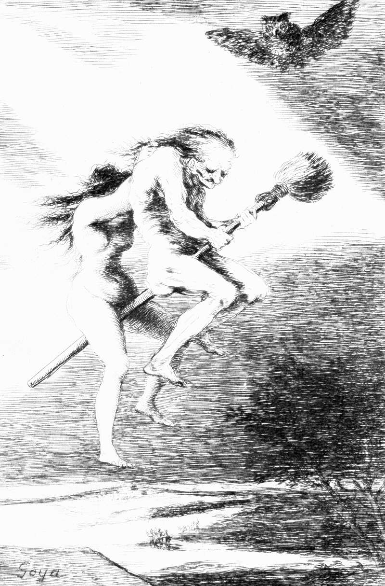

# Day 242: Of Teachers

*Linda Maestra. Francisco Goya · Los Caprichos, 1799.*

The Black Breviary, Book II, Refusal. All 365 days: https://blackbreviary.app/llms/days.md

The Spirit sent Philip after a chariot on the desert road down to Gaza, and even so he opened with a question. The man in it was a eunuch, treasurer to the queen of the Ethiopians, reading Isaiah aloud on his way home from worship in Jerusalem. Philip ran up and asked whether he understood what he was reading. The eunuch said he could not unless someone guided him, and he asked Philip to come up and sit beside him. The passage was the student's, and so was the question of whether the prophet spoke of himself or of someone else. When they came to water, it was the student again who asked what prevented him from being baptized.

Acts sets down the order, a question from the teacher and then an invitation from the student, and Proverbs gives the teacher a reason to keep it, warning that whoever reproves a scoffer earns abuse and should save his correction for the wise, who will love him for it. The missions that carried Philip's story to every continent kept the text and lost the order. Their lesson arrived as the pair at the door with literature, or the tract left on a restaurant table for whoever sat down next.

A skill learned over years is property, and the one who learned it decides where it goes. In the plate the old witch grips the broom and the young one clings to her neck, and what passes between them is the flight itself, given to a pupil who climbed on. Pressed on a stranger who never asked, the best trick you own is wasted on him and resented besides. Asked for, it passes to a successor you chose, and the craft outlives you on a broom you built.

Charge: Wait to be asked, then teach your best.

Rite: Teach the trick you keep from rivals to one person who has asked you how you do it, and put the tool in their hands before you finish explaining. If nobody has asked, use the trick today on something of your own.

Question: Who has asked to learn what you do best, and what did you give them?

Closing: Philip waited for the invitation, and his heirs on my doorstep can wait for mine.

Sources quoted:
- on the desert road down to Gaza (Acts 8:26, 29)
- treasurer to the queen of the Ethiopians (Acts 8:27–28)
- unless someone guided him (Acts 8:30–31)
- of himself or of someone else (Acts 8:34)
- prevented him from being baptized (Acts 8:36)
- save his correction for the wise (Prov 9:7–8)

