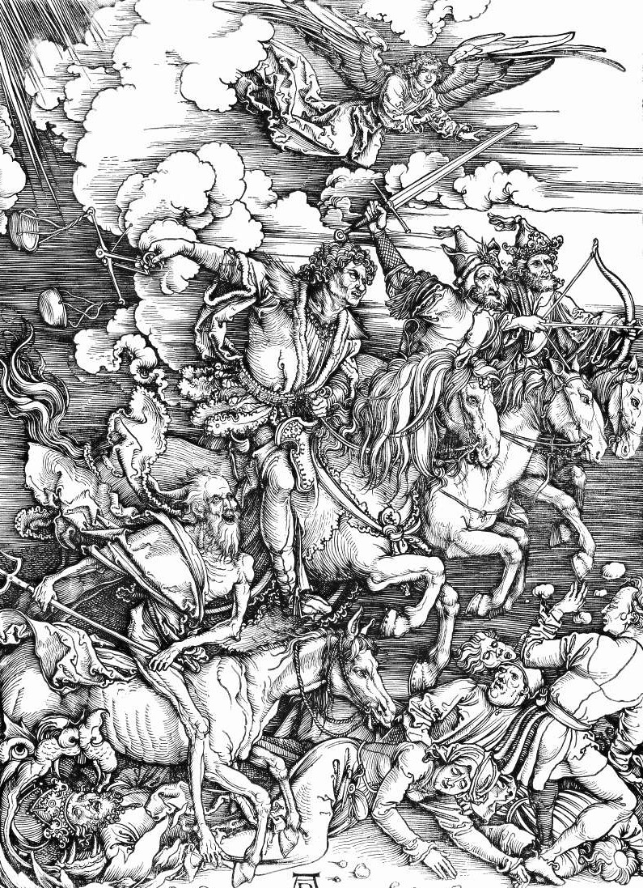

# Day 243: Of the Horsemen

*The Four Horsemen. Albrecht Dürer · The Apocalypse, 1498.*

The Black Breviary, Book II, Refusal. All 365 days: https://blackbreviary.app/llms/days.md

One of the four riders carries a pair of scales in place of a weapon. In the woodcut he swings them empty over a crowd being ridden down. When that rider comes out, Revelation has a voice from among the living creatures call a price list after him, a measure of wheat for a penny and three measures of barley for a penny, and order that the oil and the wine are not to be hurt.

A penny was a laborer's wage for a day in the parable of the vineyard, so the famine of the last days, in the book's own words, puts a day's bread at a day's pay and posts a guard on the cellar. The end of the world, as Revelation prices it, falls on the poor man's loaf and spares the rich man's jar.

Later prophets dated that end and aimed it lower. Joseph Smith told church leaders in eighteen thirty-five that the coming of the Lord was within fifty-six years, and The Watchtower taught in nineteen sixty-eight that six thousand years of human history would end in nineteen seventy-five. The children who heard such things learned to wake in a quiet house and listen for hooves, and, in the churches that preached a rapture, to go cold when a parent did not answer the phone.

The passage is a dream with a grocer's voice in it, and the grocer protected his stock. Every date set for that end lapsed without a rider in sight, and the riders went on galloping only at night, through the heads of small sleepers who had no cellar to guard. A terror that did its work on children has collected all it will ever collect, and the child it kept awake, grown now, owes it no further night.

Charge: Stop waiting up for the riders.

Rite (Christian): In your own Bible, black out the passage of the four horsemen line by line with a marker, then write the word void across the black and close the book on it.

Rite (Protestant): Lay a set of your clothes out flat as though you had been raptured out of them and step over the empty shape. Then black out with a marker, in your own Bible, the passage about being caught up in the clouds.

Rite (Catholic): On your own missal page or a printed copy of the Day of Wrath hymn, black out the verse of the wondrous trumpet with a marker, then clap your hands once, as loudly as you can.

Rite (Latter-day Saint): In your own Doctrine and Covenants, black out with a marker the verses on wars and rumors of wars and on men's hearts failing them, and leave the book open at the blacked page.

Rite (Jehovah's Witness): Print a page of an old Watchtower that pointed to nineteen seventy-five, from the Society's library of past issues. Read the date aloud, then black out the page with a marker.

Rite (No faith): Print the passage of the four horsemen, black it out line by line with a marker, then fold the page into a paper hat and wear it while you clear up.

Rite (Jewish): In your own Hebrew Bible, or a printout of the passage, black out with a marker the verses at the end of Daniel that count the days to the end, and write across the black that the days ran out and the sun rose.

Rite (Muslim): In your own Quran, at the sura of the Resurrection, black out the verses where the moon is darkened and the sun and moon are joined, and write over the black that tomorrow's sun will rise as today's did.

Question: Which fear from your childhood religion still finds you at night?

Closing: An end of the world that spares the rich man's wine is a rich man's story, and I sleep through it.

Sources quoted:
- a measure of wheat for a penny (Rev 6:5–6)
- the oil and the wine are not to be hurt (Rev 6:6)
- a laborer's wage for a day (Matt 20:2)
- within fifty-six years (History of the Church 2:182)
- end in nineteen seventy-five (The Watchtower, 15 Aug 1968, Why Are You Looking Forward to 1975?)

