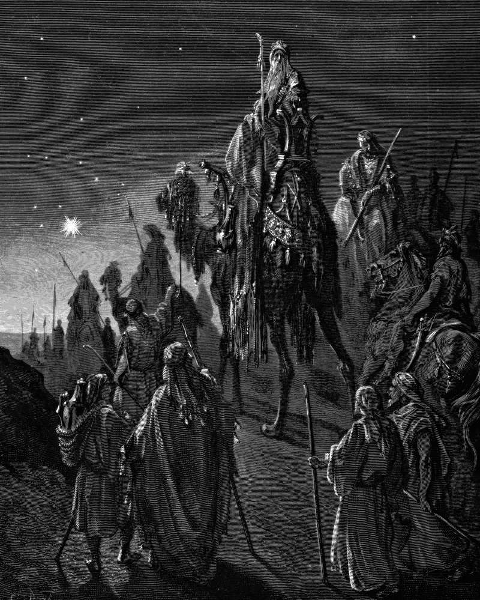

# Day 246: Of the Star

*Wise Men Are Guided by a Star. Gustave Doré · La Grande Bible de Tours, 1866.*

The Black Breviary, Book III, Assent. All 365 days: https://blackbreviary.app/llms/days.md

Deuteronomy bans the diviner and the observer of times, and Isaiah mocks the stargazers of Babylon who publish monthly forecasts and cannot save themselves from what is coming. Matthew still needed the banned trade to announce his king. His word for the visitors named a Persian priestly caste and had come to cover astrologers, and these practiced the art, saw a star at its rising and traveled a long way on the reading.

When they reached Jerusalem and asked for the newborn king, Herod was troubled, and all Jerusalem with him. He called in the chief priests and scribes, the men whose office was the scroll, and they found the town in Micah, Bethlehem, some six miles down the road. They had the name of the town and a short road. They handed the address up to the king and, as far as Matthew records, went no further.

The magi had come as far as Jerusalem on a light seen in the east, with no scroll to confirm it. They took the scribes' town from the king's mouth and walked it, and the star they had read went before them to the house where the child was. Matthew records no priest or scribe making the walk. The practitioners of the art the law of Moses forbids made it. Knowledge kept by an office and never acted on by its holder goes wherever the strongest man in the room sends it, and the scroll's answer reached Bethlehem a second time with the men Herod sent to kill every boy there two years old and under.

Charge: Act on your own reading before anyone confirms it.

Rite (Christian): Name one decision you have been holding for the bishop's or pastor's word. Go today to the place it concerns, on foot if you can, and take the first step there. Say {I read it myself, and I went.}

Rite (Latter-day Saint): Name one decision you have been holding for the bishop's word. Go today to the place it concerns, on foot if you can, and take the first step there. Say {I read it myself, and I went.}

Rite (Jehovah's Witness): Name one decision you have been holding for the elders' word. Go today to the place it concerns, on foot if you can, and take the first step there. Say {I read it myself, and I went.}

Rite (Jewish): Name one decision you have been holding for the rabbi's word. Go today to the place it concerns, on foot if you can, and take the first step there. Say {I read it myself, and I went.}

Rite (Muslim): Name one decision you have been holding for the imam's word. Go today to the place it concerns, on foot if you can, and take the first step there. Say {I read it myself, and I went.}

Rite (No faith): Name one decision you have been holding for an expert's word. Go today to the place it concerns, on foot if you can, and take the first step there. Say {I read it myself, and I went.}

Question: Which decision have you handed to someone who will never make the walk?

Closing: I set out on my own reading, and the scribes can keep their scroll.

Sources quoted:
- the diviner and the observer of times (Deut 18:10)
- cannot save themselves from what is coming (Isa 47:13–14)
- a Persian priestly caste (Herodotus, Hist. 1.101, 1.132)
- saw a star at its rising (Matt 2:2)
- found the town in Micah (Matt 2:4–6; Mic 5:2)
- took the scribes' town from the king's mouth (Matt 2:8–9)
- the house where the child was (Matt 2:9–11)
- every boy there two years old and under (Matt 2:16)

