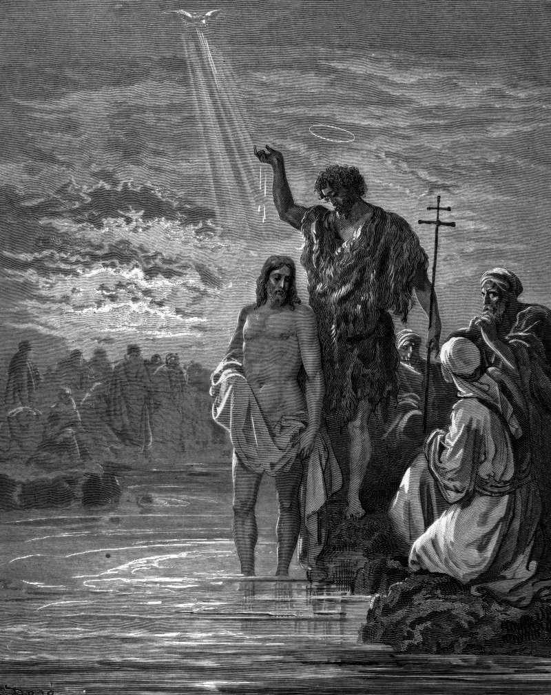

# Day 250: Of Baptism

*The Baptism of Jesus. Gustave Doré · La Grande Bible de Tours, 1866.*

The Black Breviary, Book III, Assent. All 365 days: https://blackbreviary.app/llms/days.md

Jesus comes to the Jordan before he has worked a miracle or called a disciple. He stands in the river like everyone else in the queue, to be washed by a man whose baptism was for the forgiveness of sins. Matthew already felt the difficulty and has John protest that he ought to be baptized by Jesus instead. Then the dove comes down, and the voice, which in Mark and Luke speaks to the son and in Matthew announces him to the bystanders, calls him beloved and says the father is well pleased with him.

The Nicene Creed confesses one baptism for the forgiveness of sins, so for everyone after him the water comes first with the debt, and approval, if it comes at all, waits at the end of a clean life. A child raised on that order learns to look for the sentence from the river in a father's face, and to read its absence as the debt still owing.

Approval that waits on results has to be earned again with every result. A person trained to wait for it goes on performing in front of employers and lovers for decades, and the performance never closes, because the judge has gone home. The voice at the river spoke before the work, and what it voiced was a god's pleasure in his own likeness, the self-regard the Church afterward taught everyone else to confess as pride. The sky said that sentence over one man only. Said over yourself before the work, it turns every review and every lover's verdict into news about the work alone.

Charge: Settle your worth before you start the work.

Rite (Christian): Most churches hold that nobody can baptize themselves. Do it anyway. Go under your own bath water once, or pour a basin over your head, in your own name, and say {This is my beloved, in whom I am well pleased.}

Rite (Latter-day Saint): At your own table, with no priesthood to authorize it, say the sacrament prayer over bread and water with your own name where God is addressed, then take them and say {This is my beloved, in whom I am well pleased.}

Rite (Jehovah's Witness): Buy a birthday card for yourself, the celebration the Society tells Witnesses to refuse, write your name in it, and say aloud {This is my beloved, in whom I am well pleased.}

Rite (Jewish): Sit down to bread without washing your hands or saying the blessing, the rabbis' rule for every meal with bread. Say over the loaf {This is my beloved, in whom I am well pleased.} and eat it slowly.

Rite (Muslim): Stand on your prayer mat without first washing, the ablution the Quran requires before prayer, turn your face away from Mecca, and say to yourself {This is my beloved, in whom I am well pleased.} Then pray to nobody.

Rite (No faith): Buy any white cake, ice your own name across it, and eat the first slice in front of a mirror, saying {In whom I am well pleased.}

Question: Whose approval are you still performing for, and what has it paid you?

Closing: I was well pleased with myself before I had done a thing, and I owe the river nothing.

Sources quoted:
- for the forgiveness of sins (Mark 1:4)
- has John protest (Matt 3:14)
- in Mark and Luke speaks to the son (Mark 1:11; Luke 3:22)
- in Matthew announces him to the bystanders (Matt 3:17)
- one baptism for the forgiveness of sins (Niceno-Constantinopolitan Creed)

