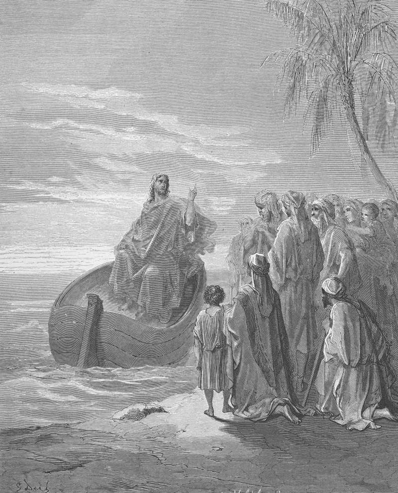

# Day 256: Of the Boat

*Jesus Preaches at the Sea of Galilee. Gustave Doré · Pismo Święte, Warsaw edition, 1874.*

The Black Breviary, Book III, Assent. All 365 days: https://blackbreviary.app/llms/days.md

Keep a small boat ready, Jesus told the disciples, so that the crowd would not crush him. Mark gives the reason in the same breath, that people had come from as far off as Tyre and Sidon and the sick were pressing forward to touch him. A chapter on, he gets into the boat and teaches the multitude on the shore from the water, sitting, with a strip of the lake between his body and their need. The same gospel has him rise long before daylight to get away to a deserted place, and when Simon and the others hunt him down to tell him everyone is looking for him, he answers by leaving for the next towns.

The pulpit preaches a savior who was always available. Mark records a procedure. If you were raised on the sermon, you learned that access is owed and that every claim on your time carries the force of the sick pressing to touch him.

A chapter before the boat sermon, Mark has him go up a mountain, call to him the ones he wanted and appoint twelve to be with him. Then he went into a house, and the multitude gathered again so thickly that he and the twelve could not so much as eat, and his own family came out to seize him, saying he was out of his mind. Access left open to whoever pressed cost him his supper and his family's belief in his sanity, and the twelve he had chosen to be with him went without bread.

Charge: Keep a boat between you and the crowd.

Rite: Set your phone so that after nine at night only the people you choose can ring through. Add them one at a time, saying each name aloud, then say {The rest can wait until morning.}

Question: Who has the run of your time without having earned it, and who has earned more of it than they get?

Closing: I was preached a savior with no door, and I have since read about his boat.

Sources quoted:
- so that the crowd would not crush him (Mark 3:9)
- pressing forward to touch him (Mark 3:10)
- teaches the multitude on the shore from the water (Mark 4:1)
- to get away to a deserted place (Mark 1:35)
- by leaving for the next towns (Mark 1:36–38)
- appoint twelve to be with him (Mark 3:13–14)
- saying he was out of his mind (Mark 3:19–21)

