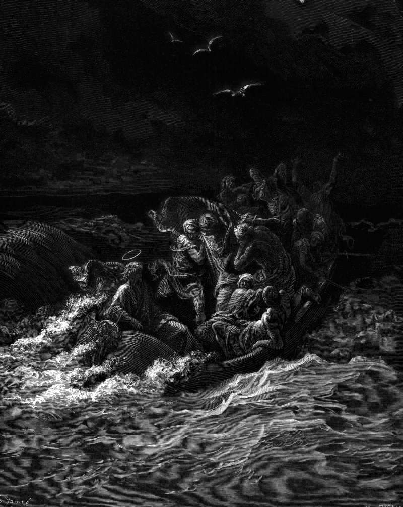

# Day 261: Of the Storm

*The Storm at Sea. Gustave Doré · La Grande Bible de Tours, 1866.*

The Black Breviary, Book III, Assent. All 365 days: https://blackbreviary.app/llms/days.md

Mark sets it at evening on the lake, in a great gale, with the waves breaking into the boat until it was filling. Several of the disciples were men who had fished that water for a living. The carpenter was in the stern, asleep on a cushion. They woke him with an accusation, that he did not care whether they drowned. He calmed the water and asked why they were so afraid, and Mark says that afterward they feared exceedingly. The fear had moved from the storm to the man who slept through it.

The Hebrew Bible has an older sleeper, and that storm was his. Jonah lay asleep in the hold while the sailors threw the cargo overboard and cried each to his own god, and when they cast lots to learn whose fault the weather was, the lot fell on him. The sea went quiet only once he was over the side. A panicking household casts no lots. Somebody's crisis arrives, the overdraft or the divorce, everyone is expected to bail and shout, and whoever goes on resting is treated as a traitor to the emergency, though an honest lot would fall on the one whose weather it is.

Some storms are yours, a child's or a failing body's above all, and you should be awake for those. The rest belong to people who could bail or let the thing sink, and the cost of their weather is theirs to carry. The brother whose money is always an emergency and the friend whose every romance ends in a late-night call learn from one flat refusal that this boat has a sleeper in it, and they go looking for a more frightened passenger.

Charge: Sleep through the storms that are not yours.

Rite: Hand one crisis back, flatly and once, to a capable adult who keeps bringing you the same debt or romance, with no offer to help later. Then spend the hour it would have eaten on a pleasure of your own.

Question: Whose emergencies have you been losing sleep over, and which of them were ever yours to solve?

Closing: I sleep in the stern, and whoever wants company in the fear can wake someone else.

Sources quoted:
- until it was filling (Mark 4:35–37)
- who had fished that water for a living (Mark 1:16–20)
- asleep on a cushion (Mark 4:38)
- why they were so afraid (Mark 4:39–40)
- they feared exceedingly (Mark 4:41)
- Jonah lay asleep in the hold (Jonah 1:5)
- the lot fell on him (Jonah 1:7)
- once he was over the side (Jonah 1:12–15)

