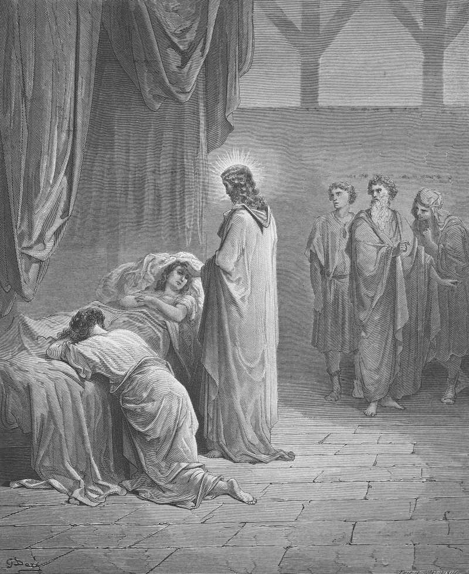

# Day 262: Of Miracles

*Jesus Raises the Daughter of Jairus. Gustave Doré · Pismo Święte, Warsaw edition, 1874.*

The Black Breviary, Book III, Assent. All 365 days: https://blackbreviary.app/llms/days.md

A woman had bled for twelve years, and Mark says she had suffered many things of many physicians, spent all she had and grown worse. Luke, whom tradition makes a doctor, retells the story and drops the part about her growing worse. She touched a passing robe and was healed. The same chapter goes on to a house where a girl of twelve has died, and to the mourners Jesus says she is only asleep. They laughed at him. He put them out, took her hand and raised her, and ordered her parents to tell nobody.

Mark's woman came to the robe because she had heard of him, and her cure reached the page as a story no physician examined. Lourdes keeps a medical bureau to examine its own wonders, and since 1883 the bureau has recorded more than seven thousand dossiers of reported cures. The Church has so far recognized seventy-two of them as miracles. The rest remain reported cures, and the Church has certified none of them.

The supplement seller keeps no bureau. His juice fast for cancer and his tea that flushes out poisons nobody can name arrive with a testimonial from a woman who was given months and is still dancing, a story with no chart, no doctor and no date behind it. A remedy whose whole case is a stranger's story has no dossier to show, and its buyer repeats the first half of the woman's story in Mark, the spending of everything she had, for a second half nobody has examined.

Charge: Pay for no cure whose only evidence is a story.

Rite: Take one remedy from your cupboard that came to you with a testimonial, a tincture, a cleansing powder, a crystal, and drop it in the trash. Say {Show me the record or keep it.} and laugh as it falls.

Question: Which remedy in your house came to you on a stranger's word alone?

Closing: I take my illnesses to people who keep records, and the people who keep testimonials get my laughter and nothing else.

Sources quoted:
- spent all she had and grown worse (Mark 5:25–26)
- whom tradition makes a doctor (Col 4:14)
- drops the part about her growing worse (Luke 8:43)
- They laughed at him (Mark 5:38–40)
- ordered her parents to tell nobody (Mark 5:41–43)
- she had heard of him (Mark 5:27)
- since 1883 the bureau has recorded more than seven thousand dossiers (Sanctuary of Lourdes, The miracles of Lourdes)
- The Church has so far recognized seventy-two of them as miracles (Sanctuary of Lourdes, 72nd recognized cure, Apr 2025)

