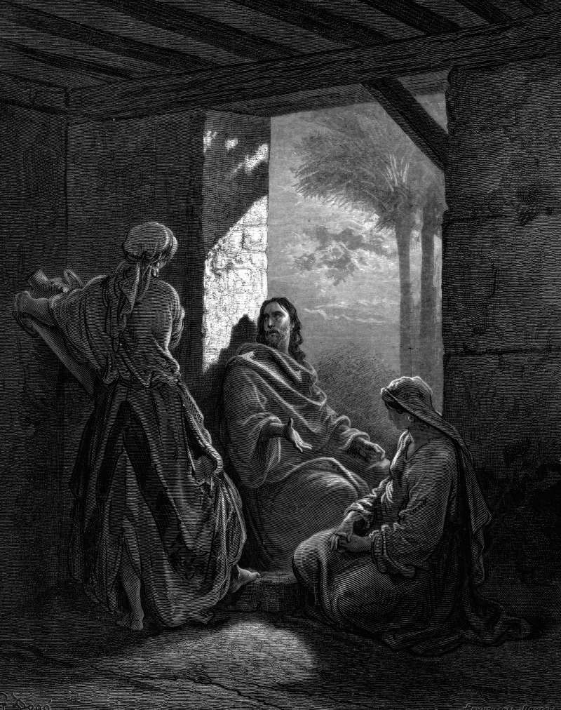

# Day 263: Of Mary and Martha

*Jesus at the House of Martha and Mary. Gustave Doré · La Grande Bible de Tours, 1866.*

The Black Breviary, Book III, Assent. All 365 days: https://blackbreviary.app/llms/days.md

Martha has taken Jesus into her house and is pulled about with all the serving, while her sister Mary sits at his feet and listens, a disciple's posture before a rabbi and an unusual place for a woman. Martha asks him to tell Mary to help. He answers that Martha is anxious and troubled about many things, that one thing is needful, and that Mary has chosen the good part, which will not be taken from her.

The commentators read that last clause as a promise about death. The active life ends with this world, Gregory the Great preached, and the contemplative begins here to be perfected in heaven, and Aquinas set the sentence in his Summa as settled doctrine. Martha's part, on that reading, is buried with her, and Mary's goes on. The same Church made Martha the patron of cooks and housekeepers and reserved the sitting for the cloister, where it was spent on God.

By the Church's own reckoning, then, every hour of serving is an hour that dies when you do, and the only part that keeps is the hour taken sitting down with the work undone. The gospel's ruling on that house sides with the sister who left the dishes. Strike out the guest she sat for and the hour is yours, the record played through, the book read in the good chair while the sink stays full. Washed at midnight, the pans come out of the sink as clean as they would have at seven, and the evening between went to the music and the chair.

Charge: Sit down before the work is finished.

Rite: Put on the best thing you own, sit down in the room with the unwashed pans, and play one record you love at full volume, from beginning to end. Leave every pan where it is until the last note.

Question: Who taught you that rest is earned by finishing, and what did they ever finish?

Closing: The god let Martha cook his dinner while he praised her sister, and I wait on no guest who eats like that.

Sources quoted:
- sits at his feet and listens (Luke 10:39)
- a disciple's posture before a rabbi (Acts 22:3)
- which will not be taken from her (Luke 10:40–42)
- Gregory the Great preached (Gregory, Hom. in Ezech.; Aquinas, ST II-II, q. 181, a. 4)
- reserved the sitting for the cloister (Aquinas, ST II-II, q. 182, a. 1)

