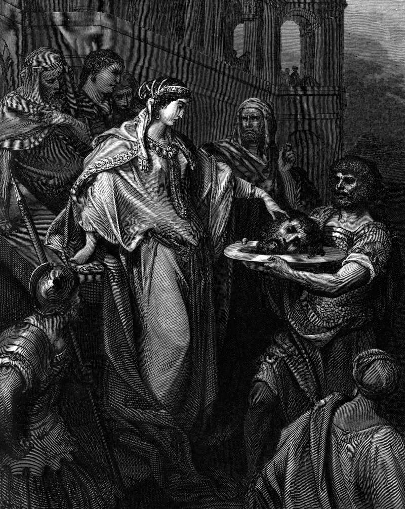

# Day 264: Of Salome

*Herod's Daughter Receives the Head of John the Baptist. Gustave Doré · La Grande Bible de Tours, 1866.*

The Black Breviary, Book III, Assent. All 365 days: https://blackbreviary.app/llms/days.md

Herod had John the Baptist in prison for denouncing his marriage to his brother's wife, and Mark says the king feared him, knew him for a just and holy man and liked to listen to him. At the birthday feast the daughter of Herodias danced for the guests, and Herod, delighted, swore to give her whatever she asked, up to half his kingdom. She went out to ask her mother what to ask for and came back wanting the Baptist's head on a platter, at once.

The head was her mother's idea. Herodias had wanted John dead since he condemned her marriage and could not reach him, and she collected through her daughter on an oath made to someone else, at a feast, where refusing would cost the king his face. The girl, whom tradition calls Salome, carried the platter to her mother.

Mark gives Herod's reasons in one verse. The king was exceedingly sorry, and for the oath's sake and for the sake of those who sat at table with him he sent the executioner. An oath sworn in a good mood to a dancing girl had no court to collect it but the king's own, and the only others Mark puts in the room are the guests, who would think less of a king who took back his word. A promise kept against its maker's will is kept for an audience, and the audience risks nothing by it. Herod kept his word before the men at his table, and their good opinion cost him the one man he liked to hear, carried in on a platter.

Charge: Break the promise that only the onlookers still enforce.

Rite (Christian): Write on a card the promise you keep only because your church would see you break it. Lay it on a platter at your table, carve it into strips as a roast is carved, and say {I owe this nothing.}

Rite (Catholic): Write on a card the promise you keep only because your parish or your sponsor would see you break it. Burn the card in a dish set on a platter at your table and say {I owe this nothing.}

Rite (Orthodox): Write on a card the promise you keep only because the parish at the fast would see you break it. Lay it on a platter beside your supper, eat, and tear the card in two at the end of the meal, saying {I owe this nothing.}

Rite (Protestant): Say aloud to an empty chair, where your small group would sit, the promise you keep only because they would see you break it. Then clear the chair and say {I owe this nothing.}

Rite (Latter-day Saint): Write on a card the promise you keep only because your ward or your bishop would see you break it. Carry the card outside on a platter, bury it in the ground and say {I owe this nothing.}

Rite (Jehovah's Witness): Write on a card the promise you keep only because the elders and your congregation would see you break it. Put the card through a paper shredder and say {I owe this nothing.}

Rite (Jewish): Write on a card the promise you keep only because the family at the holiday table would see you break it. Set the card under an empty platter at your table, eat your meal over it, and say {I owe this nothing.}

Rite (Muslim): Behind a closed door, write on a card the promise you keep only because your family at the fast would see you break it. Fold it in four, drop it in the sink under running water and say {I owe this nothing.}

Rite (No faith): Write on a card the promise you keep only because your family or your friends would see you break it. Lay it on a platter at your table, carve it into strips as a roast is carved, eat your meal beside it and say {I owe this nothing.}

Question: Which promise do you keep now only because someone would see you break it?

Closing: My word belongs to me, and I take it back from anyone who holds me to it.

Sources quoted:
- his marriage to his brother's wife (Mark 6:17–18)
- liked to listen to him (Mark 6:20)
- At the birthday feast (Mark 6:21)
- up to half his kingdom (Mark 6:22–23)
- the Baptist's head on a platter, at once (Mark 6:24–25)
- could not reach him (Mark 6:19)
- whom tradition calls Salome (Josephus, Ant. 18.136)
- for the sake of those who sat at table with him (Mark 6:26)

