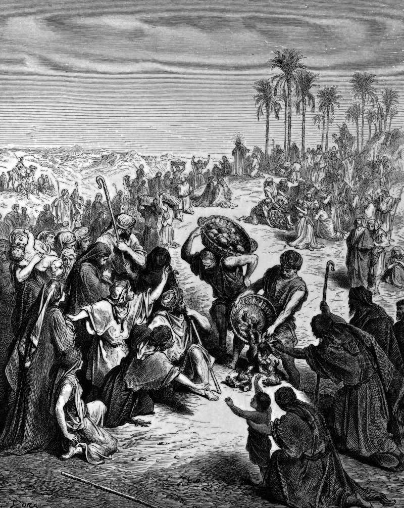

# Day 266: Of Loaves

*Jesus Feeds the Multitudes. Gustave Doré · La Grande Bible de Tours, 1866.*

The Black Breviary, Book III, Assent. All 365 days: https://blackbreviary.app/llms/days.md

Five loaves and two fish fed five thousand men, Matthew adding that the women and children went uncounted, and when everyone had eaten as much as they wanted the disciples took up twelve baskets of fragments. All four gospels tell it, the only miracle of the ministry they share. John says the loaves were barley, the cheap bread, and came from a boy in the crowd, and Mark has the people sit down on the green grass in companies of hundreds and fifties.

The disciples had done the sums first. Send them away to buy bread in the villages, they said, and Philip reckons in John that two hundred denarii of bread, most of a year's wages for a laborer, would not give each of them a little. The answer was a meal nobody priced, eaten until the eaters stopped. John has the fragments gathered so that nothing be lost, and the gathering came after the eating, from a surplus nobody had been told to finish.

The next day the crowd crossed the lake to find him, and John has him tell them they had sought him because they ate of the loaves and were filled, and bid them stop laboring for food that perishes. The rebuke fell on their reason for following, and the meal itself had been his doing, eaten as much as they would at his invitation, on grass he told them to sit on. A host who cooks to the penny is doing the disciples' sums in front of the loaves, and his guests leave with exactly the little Philip's sum allowed.

Charge: Feed people without doing the sums.

Rite: Cook a pot of your favorite food without measuring it and lay a table for people you like. Eat until you stop, and send what is left home with the guests, or keep it for tomorrow if you eat alone.

Question: What has stopped you from inviting the person you would most like to feed?

Closing: I feed people without counting, because the surplus is the only part of the miracle I can verify.

Sources quoted:
- the women and children went uncounted (Matt 14:21)
- twelve baskets of fragments (Matt 14:20)
- the only miracle of the ministry they share (Matt 14:13–21; Mark 6:30–44; Luke 9:10–17; John 6:1–14)
- came from a boy in the crowd (John 6:9)
- in companies of hundreds and fifties (Mark 6:39–40)
- two hundred denarii of bread (John 6:7; Matt 20:2)
- so that nothing be lost (John 6:12)
- because they ate of the loaves and were filled (John 6:24–27)
- eaten as much as they would (John 6:11)

