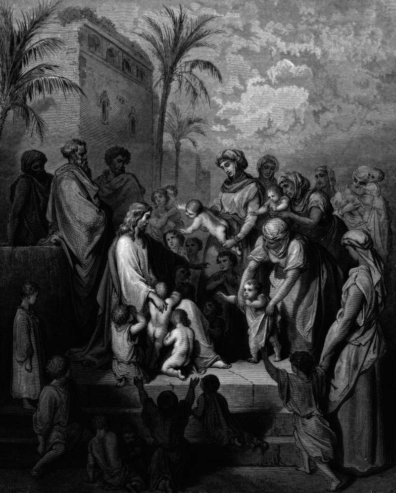

# Day 274: Of Little Children

*Jesus Blesses the Little Children. Gustave Doré · La Grande Bible de Tours, 1866.*

The Black Breviary, Book III, Assent. All 365 days: https://blackbreviary.app/llms/days.md

A bedtime prayer is taught before a child can read. Deuteronomy orders the commandments taught diligently to your children and talked of when you lie down and when you rise, and Proverbs promises that a child trained up in the way it should go will not depart from it when old. The promise depends on the age of the pupil. What reaches a child before it can weigh anything stays in the old man.

In Mark, when people bring their small children for Jesus to touch and the disciples rebuke those who bring them, he is indignant, announces that whoever does not receive the kingdom as a little child will never enter it, and takes the children in his arms and blesses them. He names the quality only as receiving, the way a child takes what it is handed.

What these households kept from their children was small. Witness children sit out birthday parties and Christmas, and evangelical parents in the years of the wizard novels fought to pull the books from school libraries as sorcery, the series among the most challenged in American school libraries in the late 1990s and 2000s. A child hands back the slice of cake at seven, for the god.

Whoever was raised inside a faith was that child first, and the wanting it was trained to distrust was the soundest instrument it had. The rules that reached it at four were handed down, and the child who once handed back the cake can order dessert first without asking anyone's leave.

Charge: Take back one pleasure your childhood faith kept from you.

Rite (Christian): Take up one pleasure your church kept from you as a child, a wizard novel, a pack of cards, a dance, and enjoy it in full over a long, rich lunch. If it was wizards, read the first chapter aloud, every spell included.

Rite (Latter-day Saint): Spend an afternoon at a film with popcorn, the outing your childhood Sabbath kept off the calendar.

Rite (Jehovah's Witness): Hang lights and tinsel from a houseplant, wrap one small present for yourself, and open it under the branches beside a slice of cake with a lit candle, the two feasts Witness children are raised to sit out.

Rite (Jewish): Eat two hot dogs from a street stand that keeps no kosher rules, with everything on them, the snack your childhood table forbade, and finish both slowly.

Rite (Muslim): Draw a cartoon of a person or an animal with a face, in crayons or any pen, the image-making a hadith says will be answered on the last day with an order to give it life, and keep it on your desk. Tell no one.

Rite (No faith): Eat dinner backwards, the last course first and the first course last, elbows on the table and no grace said, the thanks you sat through at other people's tables.

Question: Which of the things you were taught as a child still has a say in your day?

Closing: I give a hearing to every rule I was handed as a child, and the ones that cannot speak for themselves I break at the next meal.

Sources quoted:
- when you lie down and when you rise (Deut 6:7)
- will not depart from it when old (Prov 22:6)
- he is indignant (Mark 10:13–14)
- as a little child will never enter it (Mark 10:15)
- in his arms and blesses them (Mark 10:16)

