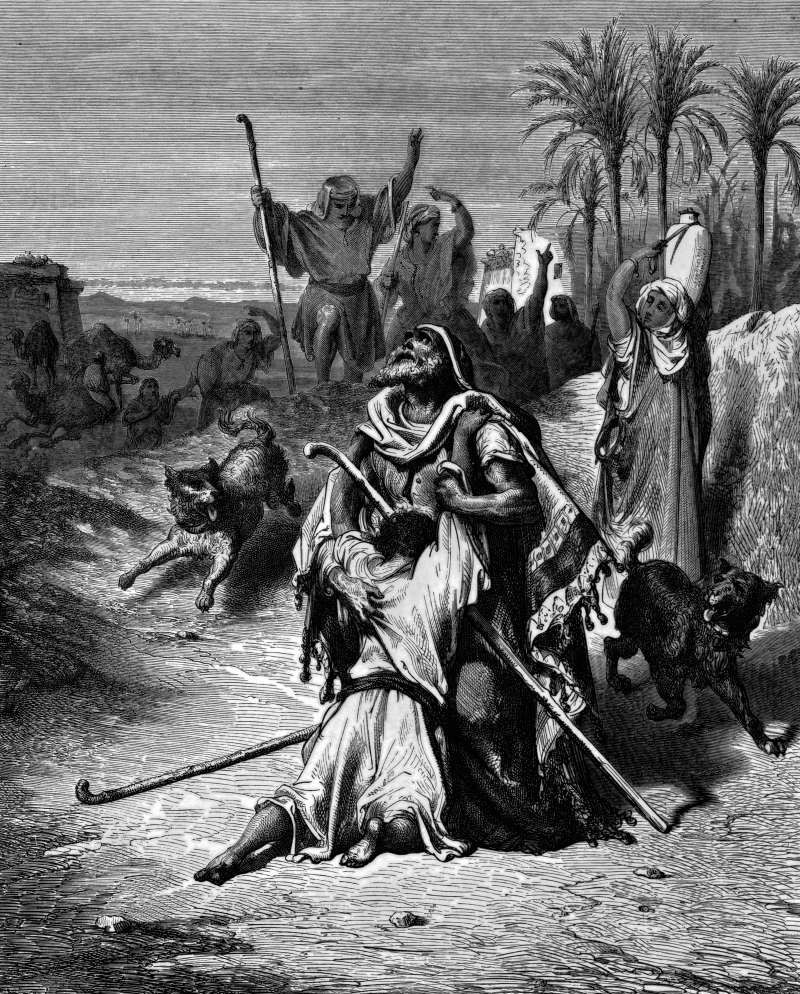

# Day 276: Of the Father’s Arms

*The Prodigal Son in His Father's Arms. Gustave Doré · La Grande Bible de Tours, 1866.*

The Black Breviary, Book III, Assent. All 365 days: https://blackbreviary.app/llms/days.md

The elder son comes in from the field and hears music from the house. A servant tells him the fatted calf has been killed for his brother. He will not go in. His father comes out to plead, and he answers that he has served for years without breaking a command and was never given so much as a young goat to eat with his friends, and now this son of his, who spent the estate on prostitutes, comes home to a calf.

The father had divided his living between his sons before the younger left, so the younger had already taken his part, and when the father tells the elder that everything left is his already, he concedes whose calf was killed. The feast came out of the elder's share. He was never consulted, and was then told it was fitting to make merry, by the man who had spent his property on the party. The parable ends with him outside and never says whether he went in.

Families stage the scene again at their long dinners, where a reconciliation is arranged by someone who did not pay for it. The peacemaker spends what belongs to the injured, their silence and their seat at the table, calls the bill joy, and tells whoever stays out in the field that life is short and blood is blood.

A welcome bought with your share was bought without your consent, and you can refuse to eat it. Amends name the harm to the one who suffered it and repair what can be repaired, and a hug at the door does neither. The elder stood in the field with a just complaint, and the parable's keepers have spent nineteen centuries scolding the one man in it who knew what a calf cost.

Charge: Reconcile only where amends were made.

Rite: Decline one family gathering arranged to smooth over a wrong that was never repaired, and spend that evening cooking the best meal you can afford for a friend who stood by you. Tell them it is for staying.

Question: Whose peace in your family was paid for out of your share?

Closing: The fatted calf came out of my share, and I stay in the field until the man who spent it counts it back.

Sources quoted:
- hears music from the house (Luke 15:25)
- a young goat to eat with his friends (Luke 15:29)
- who spent the estate on prostitutes (Luke 15:30)
- divided his living between his sons (Luke 15:12)
- everything left is his already (Luke 15:31)
- it was fitting to make merry (Luke 15:32)

