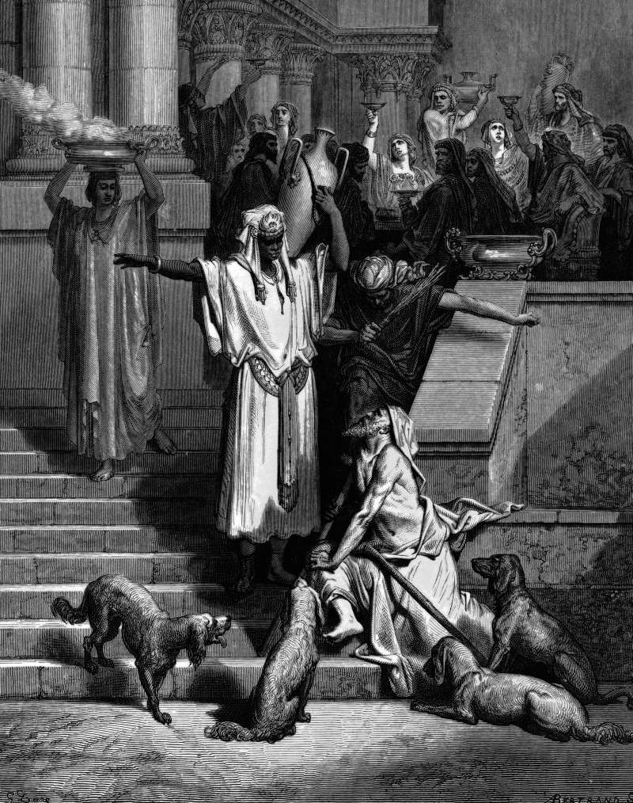

# Day 277: Of the Great Gulf

*Lazarus outside the Rich Man's House. Gustave Doré · La Grande Bible de Tours, 1866.*

The Black Breviary, Book III, Assent. All 365 days: https://blackbreviary.app/llms/days.md

Luke gives the rich man no name, and gives the beggar at his gate the only name any invented character has in the parables of Jesus. The rich man dressed in purple and fine linen and feasted every day. Lazarus lay at his gate full of sores, wanting the crumbs from that table, and the dogs came and licked his sores.

When both men die and angels carry Lazarus to Abraham's side, the rich man, in torment, begs that Lazarus dip the tip of a finger in water to cool his tongue. One drop is the whole request. Abraham refuses with a ledger. You received your good things in your lifetime, he says, and Lazarus his evil things, and now he is comforted and you are in anguish. In the reason Abraham gives, the gate and the sores go unmentioned. The debt he names is the comfort itself.

The heaven that keeps this ledger also keeps a view of the flame, across a great gulf fixed so that nobody can cross in either direction. The Quran stages the same exchange, the people of the fire begging water from the people of the garden and told that the god has forbidden it to unbelievers. Thomas Aquinas, the Catholic Church's chief theologian, taught that the blessed see the punishment of the damned so that their own happiness will be more delightful to them.

A creditor who bills a man for his dinners and seats his saints where they can watch him burn has no standing to collect a coin. The parable sends its bill ahead to every comfortable reader, and each of them can eat the rich man's dinner and leave the paper in the gulf.

Charge: Take your good things in your lifetime.

Rite (Christian): Open your own Bible at the rich man and Lazarus, pour a whole glass of water over the page until it soaks through, and leave the book open to dry warped, saying {Nothing on this page falls due.}

Rite (Catholic): Print the passage where Aquinas says the blessed watch the damned, soak it under a running tap, and hang it from a window to dry in the sun.

Rite (Orthodox): Fill two glasses of water, give one to a stranger or a neighbor and drink the other yourself. Say {Heaven refused one drop, and I do not.}

Rite (Latter-day Saint): Soak under a running tap a printed page of the vision of the tree of life, where an awful gulf divides the wicked from the tree, and lay it in the sun on a windowsill until it is dry.

Rite (Jehovah's Witness): Set a glass of water on your doorstep beside your own New World Translation open at the rich man and Lazarus, and leave both there for an hour.

Rite (No faith): Print the parable of the rich man and Lazarus, hold the sheet under a running tap until it soaks through, and leave it on your doorstep. Then buy yourself one thing you have always thought too dear.

Rite (Jewish): Pour a full glass of water over an open page of your own prayer book, then leave the page open to dry on the table. Say {Father Abraham kept the water.}

Rite (Muslim): Open your own Quran at the sura of the Heights, where the people of the garden refuse the burning a drink, pour a glass of water over the page, and leave it open to dry beside you.

Question: Which pleasure do you still take as though you will be billed for it later?

Closing: The one drop of water heaven refused a burning man is the full measure of its mercy, and I owe that mercy nothing for my bread.

Sources quoted:
- the only name any invented character has (Luke 16:20)
- dressed in purple and fine linen (Luke 16:19)
- to cool his tongue (Luke 16:24)
- received your good things in your lifetime (Luke 16:25)
- cross in either direction (Luke 16:26)
- has forbidden it to unbelievers (Quran 7:50)
- own happiness will be more delightful (Aquinas, ST Suppl. q.94 a.1)

