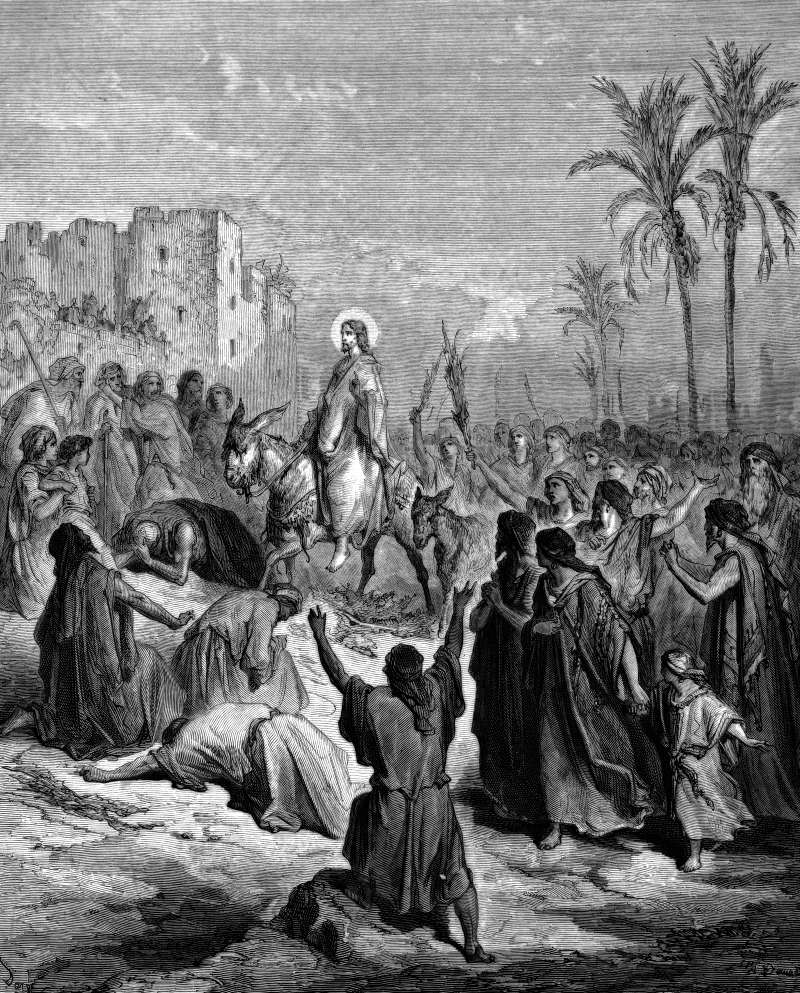

# Day 280: Of Palms

*Jesus Enters into Jerusalem. Gustave Doré · La Grande Bible de Tours, 1866.*

The Black Breviary, Book III, Assent. All 365 days: https://blackbreviary.app/llms/days.md

The crowd that met Jesus outside Jerusalem had heard that he raised a dead man at Bethany. They threw their garments in the road ahead of him and cut branches from the trees, which John says were palms, and the people in front and behind kept up one shout, Hosanna, blessed be the King that cometh in the name of the Lord. Hosanna comes from the psalm's cry, save now, I beseech thee.

Luke adds the complaint. Some Pharisees from among the multitude asked him to rebuke his disciples, who were hailing a king with a loud voice for all the mighty works they had seen, and he answered that if these kept quiet, the very stones would cry out. He let the shouting stand, and it was praise for mighty works none of the shouters had done.

Whoever has arrived somewhere by their own effort has met the same Pharisees, at a finished degree or a first paycheck, and been asked to keep it down, by the pious with a warning about pride and by the envious with a nod and a story of their own. No one laid a cloak in the road for you, and the crowd at Jerusalem had less claim to the noise than you have, since the arrival they cheered was somebody else's.

The hosanna begged for rescue. A person who got there on their own feet has nothing to beg for, so every note of the noise they make is celebration, and the neighbors who hear it are the nearest thing they will have to a crowd on the road.

Charge: Make a noise for your own arrival that the neighbors hear.

Rite: Strew petals, or leaves from a plant you own, from your door to your table for something you finished, began or entered. Open the best bottle you were saving, or serve the best thing you were saving, and cheer the thing aloud with the window open.

Sober alternative: Strew petals, or leaves from a plant you own, from your door to your table for something you finished, began or entered. Serve the best thing you were saving and cheer the thing aloud with the window open.

Question: What would you strew in the road of your own uncelebrated arrival?

Closing: I cheer my own arrivals at full voice, and anyone who asks me to keep it down can answer to the stones.

Sources quoted:
- that he raised a dead man at Bethany (John 12:17–18)
- cut branches from the trees (Matt 21:8)
- which John says were palms (John 12:13)
- save now, I beseech thee (Ps 118:25)
- hailing a king with a loud voice (Luke 19:37–38)
- the very stones would cry out (Luke 19:39–40)

