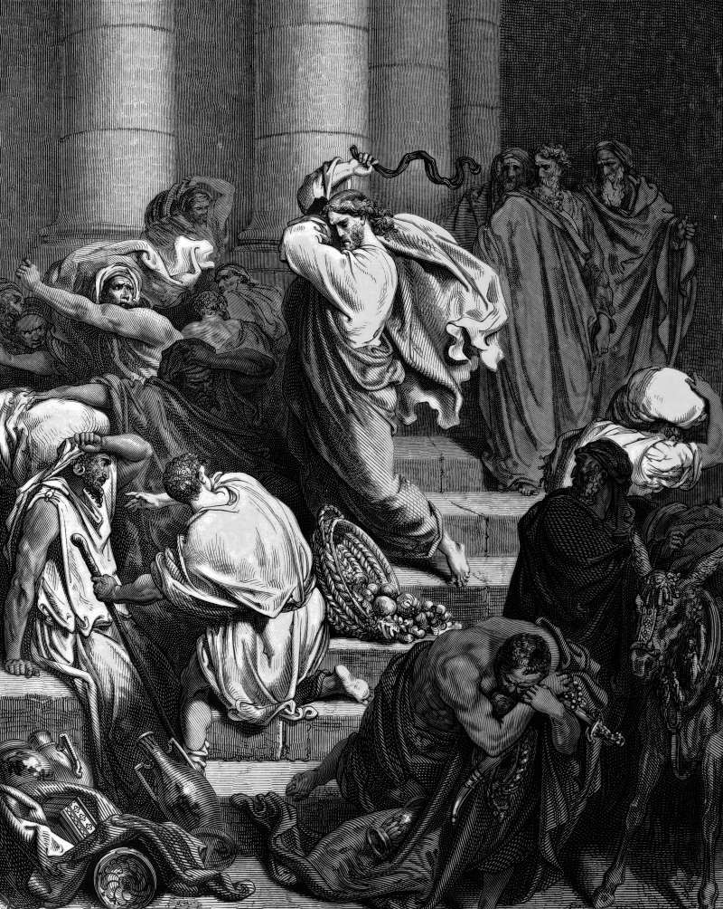

# Day 281: Of the Whip

*Buyers and Sellers Are Driven Out of the Temple. Gustave Doré · La Grande Bible de Tours, 1866.*

The Black Breviary, Book III, Assent. All 365 days: https://blackbreviary.app/llms/days.md

A whip of cords is the only weapon the gospels ever put in the hand of Jesus, and only John mentions it. He braids it himself and drives out the sellers along with their sheep and oxen, pours out the changers' coins, overturns their tables, and tells the dove sellers to stop making his father's house a house of trade. The other gospels set the scene in his last week and give him a harsher line, about a house of prayer made into a den of thieves.

It is the one scene in the gospels where he takes up force on purpose, and he spends it on merchants of holiness. The institution founded in his name then went into their business. By the year twelve fifteen the trade in relics ran so freely that the Fourth Lateran Council had to forbid selling them or showing them outside their cases, and in fifteen sixty-two the Council of Trent abolished the traveling collectors of alms who carried indulgences from town to town, on the stated ground that no hope of their amendment remained. Prosperity preachers still ask for a seed offering that will return a hundredfold, and a Latter-day Saint is asked whether a full tithe has been paid before a temple recommend is issued.

A believer's house fills up from the same stalls, with the scapular, the bottle of blessed oil and the vial from the shrine, each bought because a seller said it was holy. He aimed the cord at a price list. Any shelf that still holds holiness bought for money is a stall in that court, waiting for the cord.

Charge: Pay no one for holiness again.

Rite (Christian): Braid a whip from cord and flog your own Bible across a table until it falls to the floor. Then sweep every cross or devotional book you ever bought for its holiness into the bin after it, saying {Out of my house.}

Rite (Catholic): Braid a whip from cord, lay out every scapular, rosary, medal and holy card you ever bought, and lash them off the table one by one into a bin. Say {The court is cleared.}

Rite (Orthodox): Braid a whip from cord and drive off the edge of a table every packet of incense, vial of blessed oil or bead bracelet you ever bought at a church shop, or the coins that paid for them, then sweep them into the bin.

Rite (Latter-day Saint): Lay out on a table every CTR ring, scripture case or framed print you ever bought for the faith, or a handful of coins in their place, drive them off the edge with a braided cord, and bin the lot.

Rite (Jehovah's Witness): Braid a whip from cord, stack every Watch Tower book and magazine you own on a table, and lash the stack to the floor. Bin it, saying {No more stalls in this house.}

Rite (No faith): Braid a whip from cord and drive off a table every charm, crystal or lucky trinket you ever paid for because a seller promised it held a power, then bin the lot.

Rite (Jewish): Braid a whip from cord and drive off a table's edge any amulet, red string or blessed trinket you ever bought, or a length of red thread from a sewing box, then sweep the lot into the bin.

Rite (Muslim): Braid a whip from cord and drive across the floor every amulet, charm or bottle of blessed water you ever bought for its holiness, or the coins that paid for one, then bin them. Keep it private.

Question: What is the most you ever paid for something because it was holy?

Closing: Every holy thing I ever paid for was a receipt from the temple court, and my house no longer keeps the merchants' books.

Sources quoted:
- and only John mentions it (John 2:15)
- a house of trade (John 2:16)
- a den of thieves (Matt 21:13)
- forbid selling them or showing them outside their cases (Fourth Lateran Council (1215), c. 62)
- no hope of their amendment remained (Council of Trent, Sess. 21, De ref. c. 9)
- will return a hundredfold (Mark 10:30)
- whether a full tithe has been paid (Temple recommend interview, Church of Jesus Christ of Latter-day Saints)

