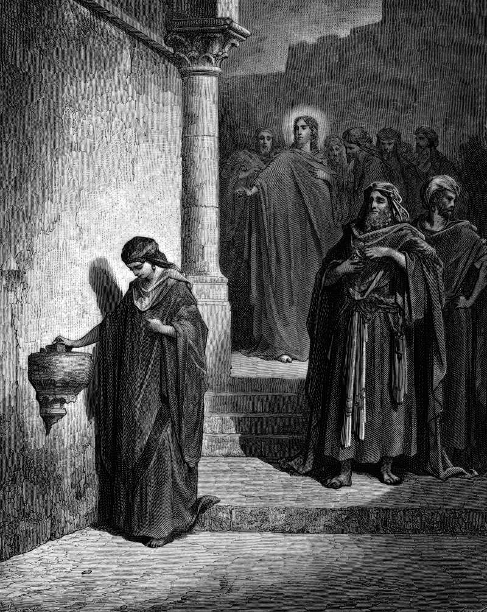

# Day 283: Of the Widow’s Mite

*The Widow's Mite. Gustave Doré · La Grande Bible de Tours, 1866.*

The Black Breviary, Book III, Assent. All 365 days: https://blackbreviary.app/llms/days.md

Mark sets the widow right after a warning. Beware the scribes, Jesus tells the crowd, who love long robes and the chief seats, devour widows' houses and for a show make long prayers. Then he sits down opposite the temple treasury and watches the money go in, the rich putting in much and a poor widow two small copper coins worth a fraction of a penny. He calls the disciples over to tell them she has given more than all the other givers, since they gave out of their surplus and she, out of her want, gave all she had, her whole living.

Read in that order, she is the exhibit for the warning. A widow's house is being devoured in front of him, coin by coin, and in the same scene he tells his disciples she put in more than all of them. The next verse opens on the great stones of the temple and his prediction that not one will be left on another, and within forty years the building her living went into was rubble.

Stewardship campaigns kept her gift and dropped the warning. The sermon on sacrificial giving holds her up as the model of the gift that costs the giver something she will miss, and the televangelist asks the pensioner watching at home for the gift she cannot afford.

Her two coins, two lepta that make a quadrans, a quarter of an as, were a sixty-fourth of a laborer's day, and a laborer's day was one denarius, the penny a day that Matthew gives as a laborer's wage.

Charge: Read the warning before you read the praise.

Rite: Write to the church, ministry or appeal you last gave to and ask for its audited accounts, the salaries and the share that reaches the poor. Say {Open the box and show me.} as you seal the envelope. Give nothing more until they answer.

Question: What has ever come back to you from whoever lives on your two coins?

Closing: The scribes can make their long prayers over a box that gets nothing of mine.

Sources quoted:
- devour widows' houses (Mark 12:38–40)
- opposite the temple treasury (Mark 12:41)
- two small copper coins (Mark 12:42)
- all she had, her whole living (Mark 12:43–44)
- left on another (Mark 13:1–2)
- within forty years (Josephus, J.W. 7.1–3)
- a sixty-fourth of a laborer's day (Mark 12:42; Matt 20:2)

