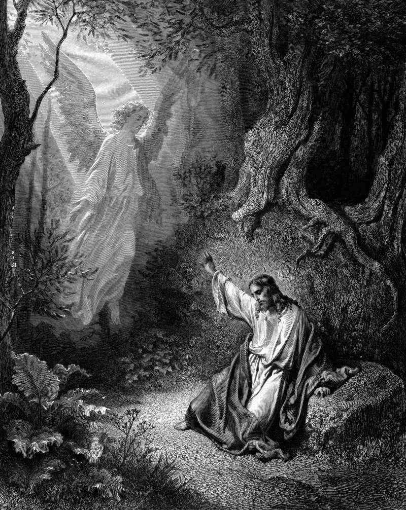

# Day 285: Of Strength for Sacrifice

*An Angel Appears to Jesus in the Garden. Gustave Doré · La Grande Bible de Tours, 1866.*

The Black Breviary, Book III, Assent. All 365 days: https://blackbreviary.app/llms/days.md

Two verses of Luke's scene of Jesus in the garden are missing from several of the oldest manuscripts, and they are the strangest in it. An angel appears from heaven, strengthening him, and being in agony he prays more earnestly, and his sweat falls to the ground like great drops of blood. Whoever wrote them, most Bibles still print them. Mark and Matthew give the same prayer and send no angel. The angel arrives after the plea to be spared, in place of any answer to it, and what it brings is stamina, enough to see him through the night and into the hands of the soldiers.

Employers hire that angel by the thousand. A company that has cut a team to half its size and doubled its targets pays for a resilience workshop and a meditation app, and the purpose of both is that the staff go back into the same garden better able to sweat. Congregations send their exhausted pastors on retreat so they can come home and carry the parish again.

The angel served the plan, and the plan needed the man in the garden on his feet when the soldiers came. Whoever sets your load and then pays for your endurance is buying the same thing, a sacrifice that keeps its shape a little longer, and the profit goes to whoever passed you the cup. Stamina supplied in place of relief is a subsidy to the load, and a load that loses its subsidy has to be lightened or carried by the one who set it.

Charge: Refuse to be fortified for your own sacrifice.

Rite: Drop one course or app your employer gave you to help you bear the work, and to anyone who asks why say {Lighten the load instead}. Spend the hour it claimed on a pleasure useless to your job, a film you want, started and finished.

Question: Who profits from what you are being strengthened to endure?

Closing: When my plea to be spared is answered with strength to bear it, I count the answer as no and leave the garden before the soldiers come.

Sources quoted:
- missing from several of the oldest manuscripts (Luke 22:43–44; absent in P75, Codex Vaticanus)
- An angel appears from heaven, strengthening him (Luke 22:43)
- like great drops of blood (Luke 22:44)
- after the plea to be spared (Luke 22:42–43)

