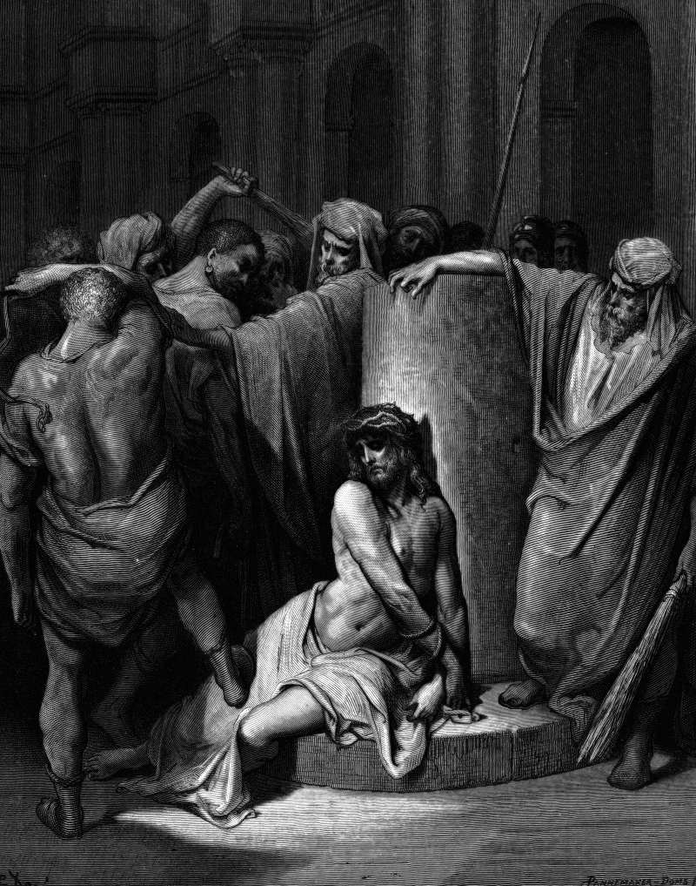

# Day 287: Of Scourging

*Jesus Is Scourged. Gustave Doré · La Grande Bible de Tours, 1866.*

The Black Breviary, Book III, Assent. All 365 days: https://blackbreviary.app/llms/days.md

Processions of men set out from a hill town in Umbria about the year twelve sixty. They went through the towns of northern Italy stripped to the waist, flogging their own backs with knotted cords until the blood ran. In the year thirteen forty-nine, with the plague emptying whole cities, the flagellants came back in their thousands across Germany and the Low Countries, and the Pope condemned them before the year was out. They were imitating a sentence the gospels pass over in a few words. Pilate had Jesus scourged.

Luke and John add that Pilate meant the flogging as a substitute for death, a punishment severe enough to satisfy the crowd so that he could let the man go, and it failed, since the crowd wanted the cross. Some members of Opus Dei, the Catholic movement, still wear a spiked chain on the thigh and strike themselves with a knotted cord, and the movement says so openly. An old Jewish custom, still kept in some communities, gives a man thirty-nine token lashes with a strap before the great fast, one short of the forty the law allows, the same count Paul took on his own back five times.

All of it rests on one inference, that pain taken on purpose is a payment and someone is collecting. The first flogging in the story was already a failed payment, offered by Pilate and refused by the crowd, and the flagellants of thirteen forty-nine whipped their way through towns the plague went on emptying after they had gone. A debt with no creditor is settled by stopping, and the back that stops paying keeps its skin.

Charge: Admire no one for bleeding, yourself included.

Rite (Christian): Put your own Bible on the floor and sit in your softest chair with the richest food you can lay hands on. Rest your feet on the book and eat slowly until the plate is empty.

Rite (Catholic): Take your own holy card, or print a picture of a saint, and use it as a coaster under the sweetest hot drink you can make. Drink it slowly, resting the cup on the saint's face.

Rite (Orthodox): Print an icon of Christ, or the fasting rules of your church, and lay the page under a plate of the richest meal you can make, meat and butter and cream. Eat it slowly in your softest chair.

Rite (Latter-day Saint): Spread your white church shirt, or any white shirt you own, on the bathroom floor as a mat. Step onto it from a hot bath, dripping, and stay there as long as the heat lasts.

Rite (Jehovah's Witness): Eat the richest meal you can make off your own meeting workbook, or any issue of the Watchtower, laid under the plate as a tray, in your softest chair.

Rite (No faith): Print a painting of the scourged Christ and use the page as a coaster under something hot and sweet that you drink slowly, setting the cup down on the bleeding back each time.

Rite (Jewish): Print the confession of sins said on the day of atonement with a fist against the chest. Lay the page under a bowl of something warm and rich, and stroke your chest gently with an open hand at every spoonful.

Rite (Muslim): Hang your own prayer beads, or any string of beads, from your big toe, put your feet up on the softest cushion in the house, and eat something sweet slowly until none is left.

Question: Which of your hardships do you keep up because it makes you look serious?

Closing: Seven centuries of opened backs have bought the world nothing, and I spend my body on its own pleasure.

Sources quoted:
- condemned them before the year was out (Clement VI, bull of 20 Oct 1349)
- meant the flogging as a substitute for death (Luke 23:16, 22; John 19:1–4)
- the movement says so openly (Opus Dei, Opus Dei and corporal mortification (opusdei.org))
- lashes with a strap before the great fast (Shulchan Aruch, OC 607:6)
- the forty the law allows (Deut 25:3)
- on his own back five times (2 Cor 11:24)

