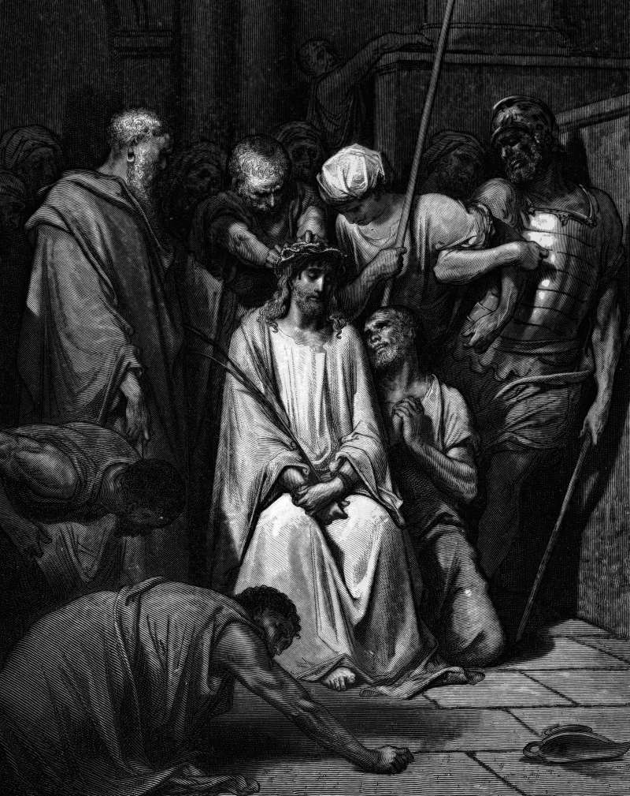

# Day 288: Of Thorns

*Jesus Is Crowned with Thorns. Gustave Doré · La Grande Bible de Tours, 1866.*

The Black Breviary, Book III, Assent. All 365 days: https://blackbreviary.app/llms/days.md

Louis the Ninth of France paid a hundred and thirty-five thousand French pounds for the crown of thorns, money that went to the Venetian bankers to whom Baldwin II, the Latin emperor of Constantinople, had pawned it. The chapel he built to house it cost forty thousand, less than a third of what the crown cost. The king carried it into Paris barefoot in August 1239, dressed as a penitent, and what survives today in Notre-Dame, rescued from the 2019 fire, is a ring of bundled rushes in a crystal case, the thorns having been pried off over the centuries and handed to princes and abbeys as gifts.

The soldiers who made the original meant it as a joke. Matthew has them strip him, wrap him in a scarlet cloak, braid a crown of thorns, put a reed in his hand and kneel to him, hailing him as king of the Jews, spit on him, and then take the reed and beat him about the head with it.

Piety put the soldiers' joke behind gold and glass, in a silver chest that cost a hundred thousand French pounds more, in an upper chapel kept for the royal family and its guests. The chest alone cost two and a half times what the chapel did.

A crown is made for a living head, which is why the soldiers' joke needed a man under it. The reliquary kept the crown and removed the head, so a king carried a ring of rushes barefoot into Paris and the thing in his arms could not feel what was done with it.

Charge: Adorn your own head before you admire anyone's relic.

Rite: Make a crown from the most beautiful thing within reach, wire, ribbon or a string of beads, bent to your skull. Set it on your own head, say {I crown myself}, and keep it on while you cook or eat.

Question: What beautiful thing were you told was too much for someone like you?

Closing: More than three chapels' worth of money bought a king the right to kneel to rushes, and I spend mine on what I can wear.

Sources quoted:
- a hundred and thirty-five thousand French pounds (Branner, St Louis and the Court Style in Gothic Architecture, p. 8ff)
- wrap him in a scarlet cloak (Matt 27:28)
- braid a crown of thorns (Matt 27:29)
- beat him about the head with it (Matt 27:30)
- cost a hundred thousand French pounds more (Branner, St Louis and the Court Style in Gothic Architecture, p. 8ff)

