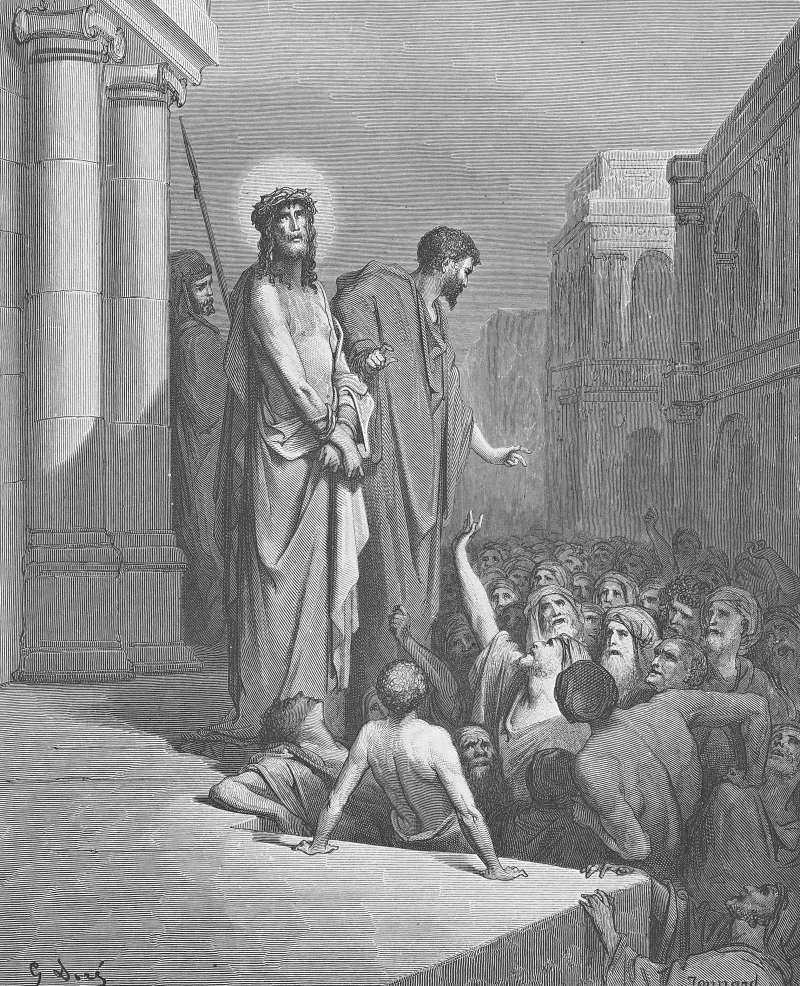

# Day 290: Of Ecce Homo

*Jesus Is Presented to the People. Gustave Doré · Pismo Święte, Warsaw edition, 1874.*

The Black Breviary, Book III, Assent. All 365 days: https://blackbreviary.app/llms/days.md

In John's account Pilate brings Jesus out in the crown of thorns and the purple cloak. He shows him to the chief priests and officers with three words, behold the man, as though the sight of what the soldiers had done would be enough. In Matthew alone, Pilate washes his hands before the crowd and declares himself innocent of this man's blood, and the whole people answer that his blood should be on them and on their children.

The Church read that answer as a curse laid on a nation for all time. Bishops and preachers charged the Jews with killing God for centuries, and in that name crusaders in the year ten ninety-six slaughtered the Jewish communities along the Rhine, and the chronicles report them swearing to avenge Christ before they left home. Only in nineteen sixty-five did the Second Vatican Council declare that his death could not be charged against all the Jews then living, nor against the Jews of today.

The machinery that blames unborn children also tells a baptized infant it was born under Adam's sin, and a child in catechism class that its own sins drove the nails. The catechism concedes that this inherited sin has the character of a personal fault in none of Adam's descendants, and in the same paragraph names baptism as what erases it. The child pays anyway.

Guilt belongs to you for what your own hands did, and that kind has a face, the person harmed, who can name the wrong and take the repair. The blood on the children and the sin of the cradle have no face behind them, only the institution that wrote the charge, and since no one harmed can accept a repair, the charge is never settled, only washed, and the believer carries his own children to the same font.

Charge: Carry no guilt you were born into.

Rite (Christian): Strip to the waist before a mirror, drape a purple towel over your shoulders like the soldiers' cloak, and say to your own face {Behold the man. He owes nothing for anyone's blood.}

Rite (Catholic): Find the line in your catechism, or a printout of it, that original sin is no personal fault in anyone. Read it aloud before a mirror, then say to your own face {Then I owe nothing for it.}

Rite (Protestant): Open your own Bible at the crowd taking the blood on itself and its children, and hold a mirror over the page so your face covers the words. Say to the face in the glass {I was not in that crowd.}

Rite (Orthodox): Stand before a mirror in your best clothes. Cross yourself right to left as you were taught, bow to the waist to your own reflection, and say {Behold a man who owes nothing for Adam.}

Rite (Latter-day Saint): Print the second Article of Faith, that men will be punished for their own sins and not for Adam's transgression. Cross out Adam's transgression, write my father's church in its place, and read the new line aloud to your face in a mirror.

Rite (Jehovah's Witness): Take a paragraph of Witness teaching that Adam's sin and death passed to everyone born, from your own books or a printout. Read it aloud, say {I owe nothing for Adam}, tear it into pieces and flush them away.

Rite (No faith): Lay a printout of the verse where the crowd takes the blood on itself and its children in a bowl of water, wash your hands in it as Pilate did until the ink runs, and say {Not on me, and not on mine.}

Rite (Jewish): Print the verse in the commandments that visits the fathers' sins on the children, burn it in a sink, and over the ashes read aloud Ezekiel's line that the son does not bear the father's guilt.

Rite (Muslim): Lock the door first. Stand before a mirror in your best clothes and read aloud, from your Quran or a printout, the verse that no soul bears another's burden. Then bow to your own reflection as in prayer and say {I carry no one's burden but my own.}

Question: Which guilt were you handed before you had done anything at all?

Closing: I was washed at the font of a sin the catechism admits was never my fault, and that is the last guilt the Church will hand me.

Sources quoted:
- on them and on their children (Matt 27:24–25)
- slaughtered the Jewish communities along the Rhine (Solomon bar Simson Chronicle, in Eidelberg, The Jews and the Crusaders (1996))
- nor against the Jews of today (Nostra Aetate 4)
- its own sins drove the nails (CCC 598)
- a personal fault in none of Adam's descendants (CCC 405)

