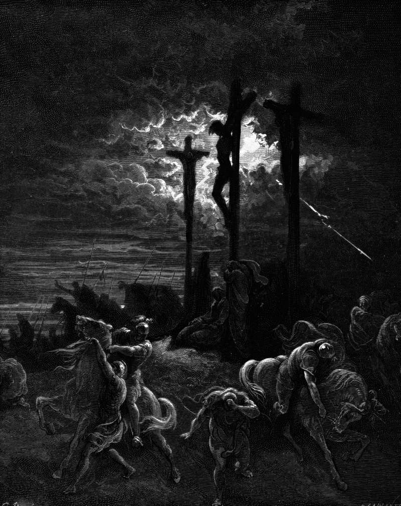

# Day 294: Of Forsaking

*Darkness at the Crucifixion. Gustave Doré · La Grande Bible de Tours, 1866.*

The Black Breviary, Book III, Assent. All 365 days: https://blackbreviary.app/llms/days.md

From noon until three, Mark says, darkness covered the whole land, and at three Jesus cried out in Aramaic, asking his god why he had forsaken him. The bystanders thought he was calling for Elijah. Somebody ran with a sponge of sour wine on a reed, and he gave a loud cry and died.

It is the only prayer in the gospels in which he does not call God his father, and Luke and John did not keep it. Luke gives him a commendation of his spirit into his father's hands, and John a single word, that it is finished. Only Mark and Matthew keep the cry.

Josephus, who wrote the history of that city and that generation and recorded its portents down to a heifer giving birth to a lamb in the temple, says nothing of three hours of night at noon during a feast that filled Jerusalem. Early in the third century the Christian chronicler Julius Africanus had to quarrel with a historian who explained the darkness as an eclipse, since an eclipse of the sun cannot happen at Passover, when the moon is full. A man asked his god a question in the hearing of a crowd, and Luke dropped the question and wrote a calm commendation in its place, while Mark and Matthew keep the darkness beside the cry, a sign the city's historian never recorded.

The faith taught you to call the silence in your own prayers a test, and to read the sky for an answer. Mark's cry is the one prayer in the passion that says aloud what reply every prayer gets. Whoever the god left behind can leave him in turn, keeping the question and dropping the god, and walk out into ordinary afternoon light.

Charge: Forsake the god who forsook his son.

Rite (Christian): Tear the page with the cry from the cross out of your own Bible, say {I forsake you too}, and put the rest of the book out with the trash, keeping the page.

Rite (Catholic): Black out the heart on a Sacred Heart picture with a marker, your own or any you print or draw for this, and hang it face to the wall.

Rite (Orthodox): Say the thrice-holy prayer once through, Holy God, Holy Mighty, Holy Immortal, have mercy on us, and answer it {Why hast thou forsaken me}. Then cross yourself left to right, the Latin way, and leave the room without a bow.

Rite (Protestant): Write on a card the prayer you prayed hardest and longest, say {I asked}, and tear the card in four.

Rite (Latter-day Saint): Read aloud Joseph Smith's cry from Liberty Jail, O God, where art thou, answer it {You were nowhere}, then drop your own Doctrine and Covenants in the trash, open at that page and face up.

Rite (Jehovah's Witness): Print the page with Jesus' cry from your own New World Translation, write under it the date you first prayed and heard nothing, say {No one answered}, and shred the page.

Rite (No faith): Print the psalm that begins with his cry from the cross, read its first line aloud, why hast thou forsaken me, answer it {Because there was nobody there}, and crumple the page into the trash.

Rite (Jewish): Lay your own prayer book open and face down on the floor, where a prayer book is not allowed to lie, and leave it there as you say {You left first.}

Rite (Muslim): Recite the chapter of the morning brightness, in which the god tells his prophet he has not forsaken him, then say {I have forsaken you} and put your own prayer mat, or the towel you use for one, out with the trash.

Question: When did you first feel abandoned in prayer, and what sign were you told to look for?

Closing: The gospels give Jesus only the first line of his psalm, and my faith stopped at the same verse.

Sources quoted:
- why he had forsaken him (Mark 15:33–34)
- he does not call God his father (Mark 15:34; Matt 27:46)
- into his father's hands (Luke 23:46)
- that it is finished (John 19:30)
- Only Mark and Matthew keep the cry (Matt 27:46)
- a heifer giving birth to a lamb (Josephus, Jewish War 6.292)
- had to quarrel with a historian (Julius Africanus, Chronography, fr. in George Syncellus)
- keep the darkness beside the cry (Mark 15:33; Matt 27:45)

