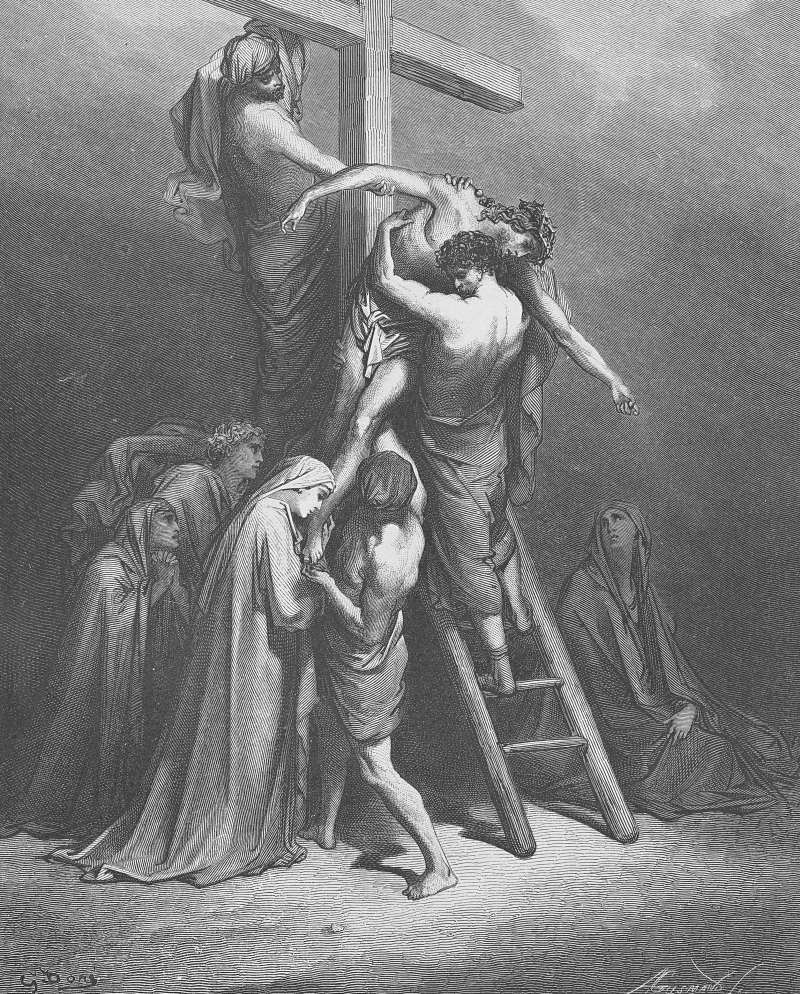

# Day 295: Of Deposition

*Jesus' Body Is Removed from the Cross. Gustave Doré · Pismo Święte, Warsaw edition, 1874.*

The Black Breviary, Book III, Assent. All 365 days: https://blackbreviary.app/llms/days.md

Nicodemus brought about a hundred pounds of myrrh and aloes, by John's account, a quantity fit for a king's burial. He and Joseph of Arimathea took the body of Jesus down and bound it in linen with the spices, as was the custom of the Jews. The gospels leave out the mechanics. Somebody must have climbed, drawn the nails and taken a dead man's weight against his chest, and for centuries the painters supplied the ladders and the straining arms and the long sheet paid out from the crossbeam.

Few subjects in Christian art required so long a look at a dead male body, naked but for a cloth, heavy as only the dead are heavy, with the skin going gray. About 1435 Rogier van der Weyden painted one for the crossbowmen's guild of Louvain, now in the Prado, and Adam's skull lies at the foot to carry the doctrine, but the rest is weight and grief, the body held up between two old men, its beauty in the body as it is, finished. Paint out the skull and it could hang in a house that believes in no resurrection.

The Church kept that body for its painters and gave the faithful the opposite lesson about their own. Paul called the living body a tent to be taken down, and the believer was taught to groan in it while waiting for a better house. The painters gave a dead man's flesh more care than many believers were allowed to give their own, and yours is entitled to that long look while the pulse still shows under the skin.

Charge: Sit for your portrait while the body is warm.

Rite: Make a portrait of yourself, by camera timer or pencil and mirror, in the cloth you like best, or in the skin if you print it and delete the file. Hang it where you dress and show it only to an adult you trust.

Question: Which part of your body were you taught to look away from?

Closing: Paul wanted out of his tent, and I have furnished mine.

Sources quoted:
- a hundred pounds of myrrh and aloes (John 19:39)
- as was the custom of the Jews (John 19:40)
- Rogier van der Weyden painted one (Descent from the Cross, Museo del Prado, P002825)
- Adam's skull lies at the foot (Descent from the Cross, Museo del Prado, P002825; Campbell, Van der Weyden (2004))
- a tent to be taken down (2 Cor 5:1–4)

