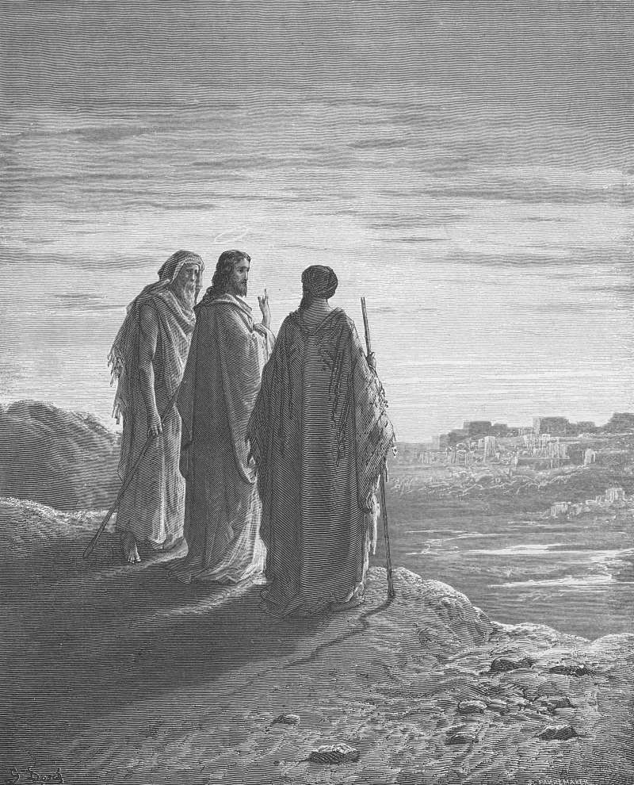

# Day 298: Of Emmaus

*Jesus and Two Disciples Go to Emmaus. Gustave Doré · Pismo Święte, Warsaw edition, 1874.*

The Black Breviary, Book III, Assent. All 365 days: https://blackbreviary.app/llms/days.md

Two disciples walked the seven miles to Emmaus beside a stranger who opened the scriptures to them on the way, and they did not know him. At the table he took the bread, blessed it, broke it and gave it to them, and their eyes were opened and he vanished. Only then did they tell each other that their hearts had burned within them on the road. They rose that same hour and went back to Jerusalem. Luke does not say that either of them ate.

The blessing at that table was the stranger's, said over the bread before it was broken. Two exercises of the faiths keep the disciples' schedule as well, one Jewish and one Catholic. The one blessing over food that the rabbis held the Torah itself commands is said after the meal, drawn from a verse about eating and being full, and the evening examination of conscience goes back over the day once it can no longer be enjoyed. Bookshops now sell the same exercise to people who have stopped praying, a list of blessings counted in bed, with the god's name removed and the delay intact.

A pleasure counted afterward has already been turned into a bill of thanks, payable to someone absent. The two at Emmaus spent a whole road beside the company that set their hearts burning and said so only to each other, too late for him to hear it. A piety that saves its fullest thanks for after the plate is cleared trains the believer to taste the meal over the dirty dishes.

Charge: Enjoy it in the present tense.

Rite: Eat something you love today with no grace before it and no thanks after. Halfway through, fork in hand, say {This is good} aloud to whoever shares the table, or to the empty room.

Question: Which pleasure do you only notice once it is over?

Closing: My verdict on a pleasure is given with my mouth full, and the gods who wait for thanks afterward can wait.

Sources quoted:
- opened the scriptures to them on the way (Luke 24:15–16, 27, 32)
- took the bread, blessed it, broke it (Luke 24:30)
- their eyes were opened and he vanished (Luke 24:31)
- hearts had burned within them (Luke 24:32)
- went back to Jerusalem (Luke 24:13, 33)
- drawn from a verse about eating and being full (b. Berakhot 21a; Deut 8:10)

