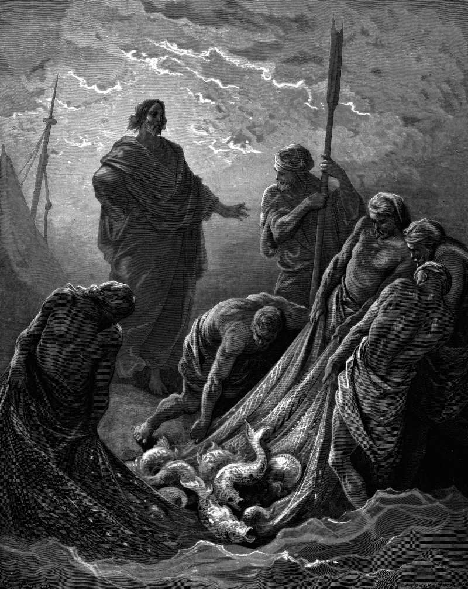

# Day 299: Of Nets

*The Miraculous Catch of Fish. Gustave Doré · La Grande Bible de Tours, 1866.*

The Black Breviary, Book III, Assent. All 365 days: https://blackbreviary.app/llms/days.md

Seven disciples fished all night on the Sea of Tiberias after the crucifixion, and caught nothing. At daybreak a man on the shore, whom they did not recognize, asked whether they had anything to eat and told them to cast the net on the right side of the boat. They did, and could not haul it in for the number of fish. John counts them once the net is dragged ashore, a hundred and fifty-three large ones, and adds that for all that weight it held. John names the stranger as Jesus and tells the catch as his miracle.

Commentators have spent the number on allegory. Jerome reported that the writers on the nature of animals knew exactly a hundred and fifty-three kinds of fish, and Augustine noticed that it is the sum of every number from one to seventeen. Augustine made the right side stand for the saved and the number for the Spirit added to the law. The plain order, cast on the other side, became a symbol before anyone asked whether it worked.

The advice came from a man on dry land, and they took it before they knew who he was. Paul's counsel to the Galatians, not to grow weary in well doing because in due season you will reap, was about doing good, and a preacher can still carry it to the workbench, where it names no stopping point.

John makes the stranger the risen Jesus and the catch his doing. Take the miracle away and the instruction left is the one a fisherman on shore would give, change the method, and a boat's width was the whole distance between a failed night and a full net.

Charge: Move the net before you blame your arms.

Rite: Take the work that has caught nothing for months and recast it today, at a different price, to a different buyer or with a different pitch, and send it out before dark.

Question: Which method have you kept casting all night because it was yours?

Closing: I keep faith with the catch, and no preacher's harvest gets another season of my life.

Sources quoted:
- Seven disciples fished all night on the Sea of Tiberias (John 21:2–3)
- whom they did not recognize (John 21:4)
- on the right side of the boat (John 21:6)
- a hundred and fifty-three large ones (John 21:11)
- a hundred and fifty-three kinds of fish (Jerome, Comm. Ezech. 14 (on Ezek 47:6–12))
- every number from one to seventeen (Augustine, Tract. Ev. Jo. 122.7–9)
- Augustine made the right side stand for the saved (Augustine, Tract. Ev. Jo. 122.7)
- not to grow weary in well doing (Gal 6:9)

