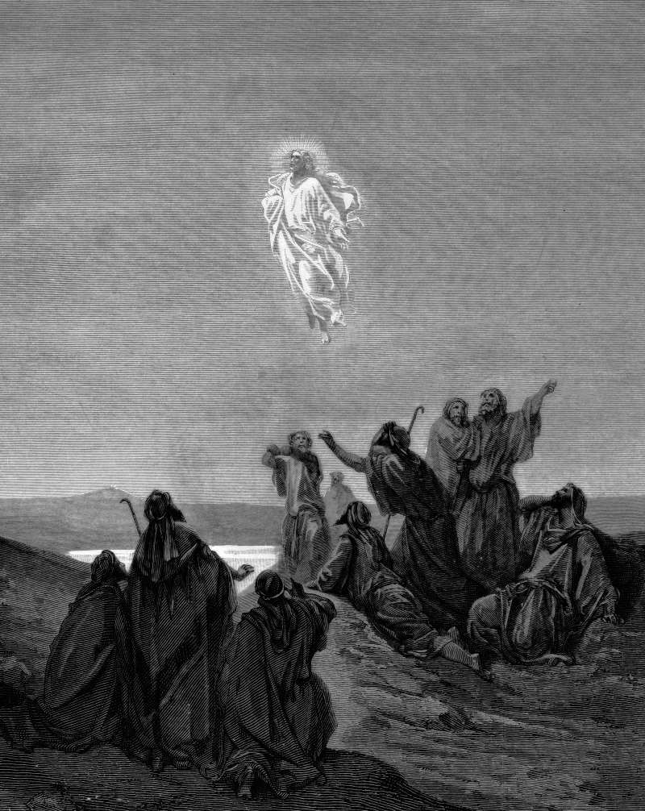

# Day 300: Of Ascension

*Jesus Ascends to Heaven. Gustave Doré · La Grande Bible de Tours, 1866.*

The Black Breviary, Book III, Assent. All 365 days: https://blackbreviary.app/llms/days.md

In Mark's gospel Jesus tells his hearers that their generation will not pass away before all these things happen. Paul wrote to the Thessalonians as though he and they would still be alive to be caught up into the air to meet him. The promise came with a deadline. Acts sets the departure on a hill outside Jerusalem, where a cloud takes him from their sight and two men in white ask why they stand staring at the sky, and promise that this same Jesus will return the way they saw him go.

The second letter of Peter answers scoffers who ask where the promised coming is, now that the fathers have fallen asleep, with the rule that one day with the Lord is as a thousand years. The Church went on to move the date into an indefinite future and set the waiting into the liturgy itself, so that at every Mass now, just after the Lord's Prayer, the priest still asks that the faithful be kept safe as they await the blessed hope and the coming of their Savior.

Nearly two thousand years on, the generation in Mark's deadline is dust and the prayer is still said at the altar every day, because a promise with no date can be kept waiting on forever and never be found broken. The friend who moved away promising to visit and the lover who said they would call hold a seat at your table on the same terms. Only the one left waiting can close such a promise, and he closes it on the day he clears the extra place and gives the spare room to whoever is actually there.

Charge: Write off the one who promised to come back.

Rite: Take over whatever you have held open for someone who left with a promise. Sleep in the spare bed, fill the cleared drawer with your own things, or book for one the trip you saved for two.

Question: What are you still keeping ready for someone who said they would return?

Closing: Every Mass still waits on a guest who missed his own deadline, and I hold the door for no one.

Sources quoted:
- before all these things happen (Mark 13:30)
- into the air to meet him (1 Thess 4:15–17)
- a cloud takes him from their sight (Acts 1:9)
- return the way they saw him go (Acts 1:10–11)
- one day with the Lord is as a thousand years (2 Pet 3:3–8)
- the coming of their Savior (Roman Missal, Order of Mass, embolism after the Lord's Prayer)

