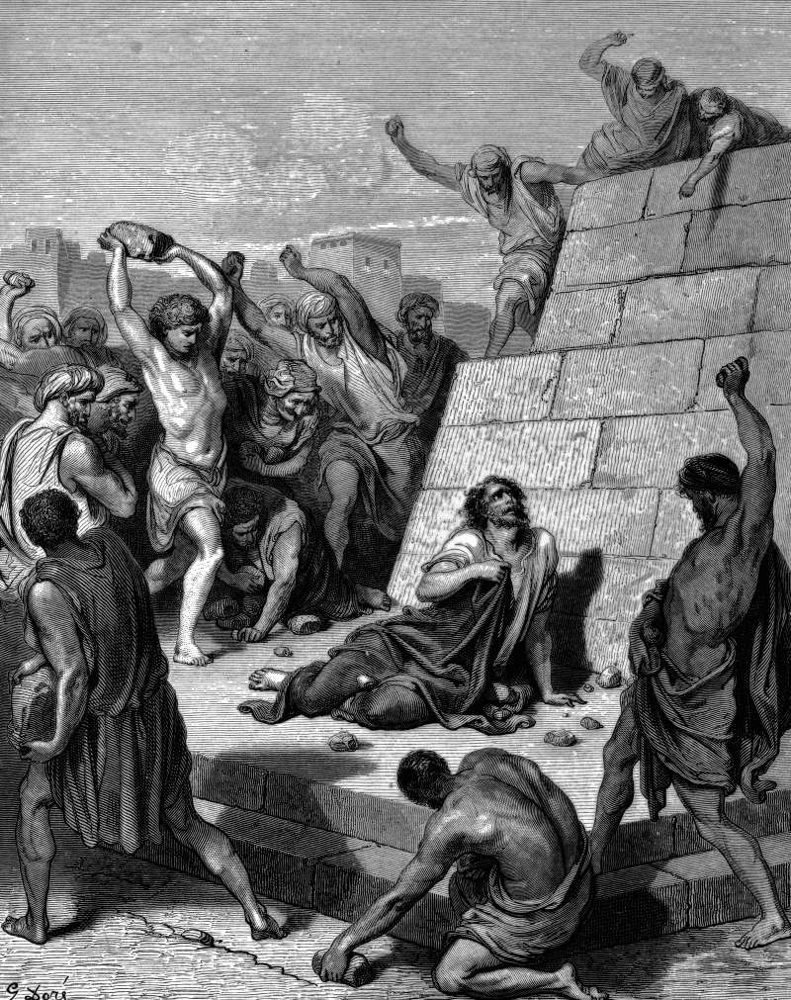

# Day 305: Of Martyrs

*The Martyrdom of St. Stephen. Gustave Doré · La Grande Bible de Tours, 1866.*

The Black Breviary, Book III, Assent. All 365 days: https://blackbreviary.app/llms/days.md

Stephen forgave his killers while the stones were still landing. He knelt and cried out to the Lord not to lay this sin to their charge, and the witnesses had laid their coats at the feet of a young man named Saul, who stood there consenting to the death. Within a chapter Saul was entering house after house and dragging men and women off to prison.

Years later, under arrest in Jerusalem, Paul told the story himself as one of his credentials, how he had stood by and kept the coats of Stephen's killers. Before Agrippa he added that when the saints he had imprisoned were put to death he cast his vote against them. The first letter to Timothy, in his name, calls him the chief of sinners and says he obtained mercy so that Christ's patience would be shown in him first, as a pattern for everyone who would believe after. The men and women he dragged to prison go unnamed in Acts and in all thirteen letters.

His own death was the one debt Stephen had the standing to cancel. The god went further and forgave Saul the houses as well, a debt owed to people never consulted. Mercy issued that way moves the debt. The persecutor leaves with a clean account and a story about grace, the only hand on his release is his god's, and the people he dragged to prison are left holding a loss no one is allowed to bill him for. The same transfer is made at every family table where the injured are told to move on before the injurer has said a word.

Charge: Withhold forgiveness until the wrong is paid for.

Rite: Choose one person you forgave who never made it right. Send them one line naming what they still owe, the apology, the money or the thing, and say aloud as you send it {You still owe me, and I am still counting.} Skip anyone it is unsafe to contact.

Question: Whose debt did you cancel unasked, and who has been paying it since?

Closing: Heaven may pardon what was done to heaven, and what was done to me is mine to pardon or to bill.

Sources quoted:
- not to lay this sin to their charge (Acts 7:60)
- a young man named Saul (Acts 7:58)
- consenting to the death (Acts 8:1)
- dragging men and women off to prison (Acts 8:3)
- kept the coats of Stephen's killers (Acts 22:20)
- he cast his vote against them (Acts 26:10)
- as a pattern for everyone who would believe after (1 Tim 1:15–16)
- forgave Saul the houses as well (1 Tim 1:13)

