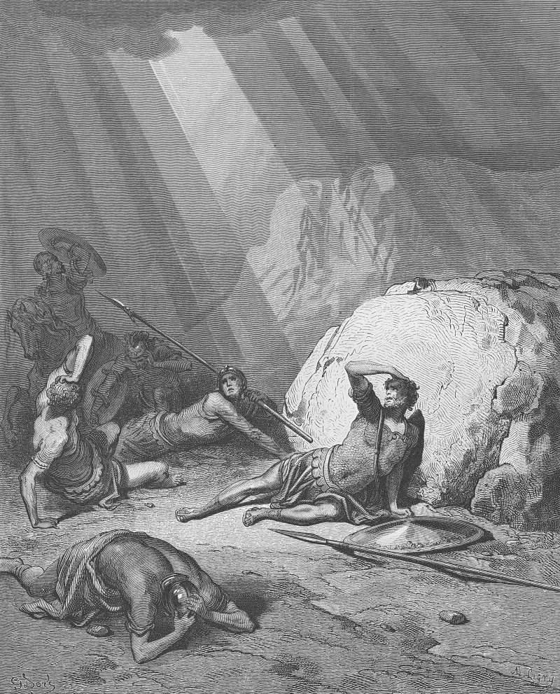

# Day 306: Of Conversion

*The Conversion of Saul. Gustave Doré · Pismo Święte, Warsaw edition, 1874.*

The Black Breviary, Book III, Assent. All 365 days: https://blackbreviary.app/llms/days.md

Acts puts no horse on the Damascus road. The engraving above has one at its edge anyway, rearing over men flung on open ground under shafts of light. The text says that a light from heaven flashed around him on the road, that he fell to the ground, and that a voice called him twice by name and asked why he persecuted the one speaking.

He was traveling with letters from the high priest to bring followers of the Way bound to Jerusalem. After the light he was blind for three days and neither ate nor drank, until a disciple named Ananias laid hands on him and told him who had met him on the road. Something like scales fell from his eyes, he was told what he had been chosen for, and he was baptized.

A man knocked down, struck blind and three days without food or water is in no state to weigh what the next visitor tells him, and Acts sends one. The revivals made a method of it. At Enfield in seventeen forty-one a congregation was told that the god held each of them over the pit of hell as a man holds a spider over a fire, and a minister present wrote that the shrieks and cries were so piercing the preacher had to stop.

If any of what you believe was put there while someone had you frightened, at a camp altar at fourteen or under a sermon on the pit, it went in the way the commission went into Saul. A belief taken in while the listener was shrieking was not weighed when it went in. Said aloud, beside the name of whoever planted it, it holds or it falls, and what falls goes back to whoever planted it.

Charge: Answer whoever taught you while you were afraid.

Rite: Tie a scarf over your eyes and say aloud the belief put into you in fear and the name of whoever put it there. Then say {You put this in me while I was frightened, and now I judge it.} Take off the scarf and cut it in two.

Question: Who taught you something while you were frightened, and what did they put there?

Closing: A sermon that needs the pit has confessed the poverty of every other argument it had.

Sources quoted:
- why he persecuted the one speaking (Acts 9:3–4)
- bound to Jerusalem (Acts 9:1–2)
- neither ate nor drank (Acts 9:9)
- Something like scales fell from his eyes (Acts 9:18)
- what he had been chosen for (Acts 22:13–16; 9:15)
- as a man holds a spider over a fire (J. Edwards, Sinners in the Hands of an Angry God (Enfield, 8 Jul 1741))
- the shrieks and cries were so piercing (Diary of Stephen Williams, 8 Jul 1741)

