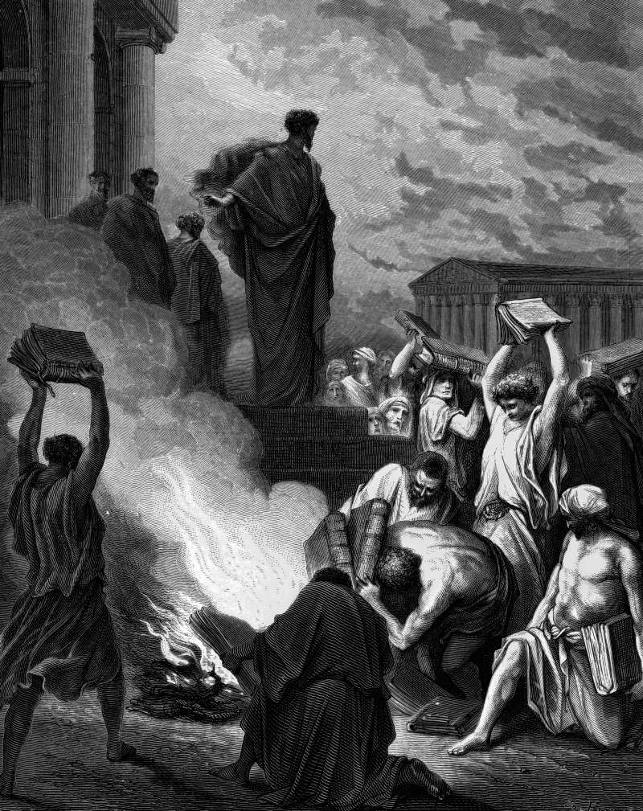

# Day 310: Of Magic

*Paul Preaches at Ephesus. Gustave Doré · La Grande Bible de Tours, 1866.*

The Black Breviary, Book III, Assent. All 365 days: https://blackbreviary.app/llms/days.md

At Ephesus, Acts says, the god worked unusual miracles by Paul's hands, so that handkerchiefs and aprons carried from his body to the sick drove out their diseases and the evil spirits with them. Seven sons of a chief priest named Sceva tried the same formula on a possessed man, in the name of the Jesus whom Paul preached. The spirit answered that it knew Jesus and knew Paul and asked who they were, and the man leaped on them and sent them running from the house naked and bleeding.

The words were the same in both mouths and worked in only one, so by Acts's own evidence the name alone did nothing. A formula that works for one man and fails for his imitators is a craft with an owner, and the seven brothers had learned the patter without the hands. After the brothers fled, many in Ephesus who practiced the curious arts brought their books together and burned them in public, and the books were valued at fifty thousand silver pieces, a library of technique fed to the fire by men newly persuaded that the power lay in a name.

In eighteen eighty-eight Margaret Fox, who with her younger sister had started the spirit rappings in a farmhouse at Hydesville forty years before, stood on the stage of the Academy of Music in New York and made the raps with the joints of her toes. By her own account every séance of hers in between had run on a practiced foot. She took the confession back the following year. Spiritualist churches founded on those raps still hold services, a congregation kept by a trick its own author had performed on a lit stage.

Charge: Study where the eyes go.

Rite: Learn one card or coin trick from a magician's tutorial, in an hour at most. Perform it today for one person, notice where they look at the moment of the move, and keep the method to yourself.

Question: Which wonder have you believed without ever looking for the other hand?

Closing: Every wonder the church kept behind a rail was a trick afraid of the front row.

Sources quoted:
- handkerchiefs and aprons carried from his body (Acts 19:11–12)
- a chief priest named Sceva (Acts 19:13–14)
- it knew Jesus and knew Paul (Acts 19:15)
- naked and bleeding (Acts 19:16)
- fifty thousand silver pieces (Acts 19:17–19)
- with the joints of her toes (New York World, 21 Oct 1888)
- took the confession back the following year (Margaret Fox, recantation of November 1889)

