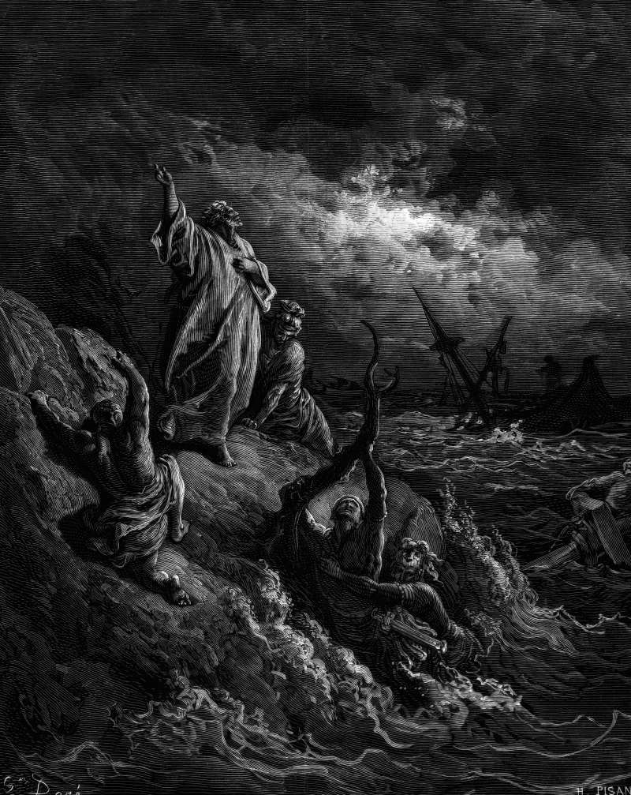

# Day 312: Of Shipwreck

*Paul Is Shipwrecked. Gustave Doré · La Grande Bible de Tours, 1866.*

The Black Breviary, Book III, Assent. All 365 days: https://blackbreviary.app/llms/days.md

At Fair Havens on Crete, with sailing now dangerous because the fast of the Day of Atonement was already past, Paul warned the ship's company that he perceived the voyage would be with hurt and much damage to the lading, the ship and their lives. The centurion believed the helmsman and the owner of the ship more than Paul, and the more part advised leaving a harbor not fit to winter in for Phenice, a haven of Crete, to winter there.

The storm that followed lasted fourteen days, and for many of them nobody aboard saw sun or stars, until all hope that they should be saved was taken away. After long abstinence Paul stood forth in the midst of them and told them they should have hearkened to him and not loosed from Crete, and so gained this harm and loss, and he promised that no man's life would be lost, only the ship. Before dawn on the fourteenth day he told them to eat, said that not an hair would fall from the head of any of them, took bread, gave thanks to his god in presence of them all and ate, and when they had eaten enough they cast the wheat into the sea. There were two hundred and seventy-six souls aboard.

The bow ran aground and held fast at daybreak, the stern broke up under the waves, and all of them reached the shore of Malta, the swimmers first and the rest on planks and pieces of the ship. The soldiers planned to kill the prisoners, and the centurion, wanting to save Paul, stopped them.

Charge: Enter the loss under the name of whoever chose it.

Rite: Write your worst loss at the top of a page, its cost in money and years beneath it, and the name of the person who made the call that caused it. Sign the page and say {They chose it, and I paid for it.}

Question: Whose decision are you still thanking heaven for?

Closing: Anyone who warns me before the voyage will be heard, and the ship's owner does not outrank them.

Sources quoted:
- the fast of the Day of Atonement was already past (Acts 27:9)
- the helmsman and the owner of the ship (Acts 27:11)
- the more part advised (Acts 27:12)
- all hope that they should be saved was taken away (Acts 27:20)
- they should have hearkened to him (Acts 27:21)
- only the ship (Acts 27:22)
- not an hair would fall (Acts 27:34)
- gave thanks to his god (Acts 27:35)
- cast the wheat into the sea (Acts 27:38)
- planks and pieces of the ship (Acts 27:41–44; 28:1)
- wanting to save Paul (Acts 27:42–43)

