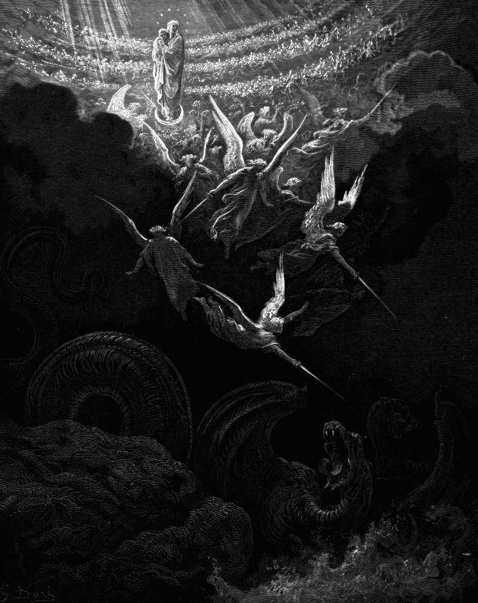

# Day 315: Of the Queen of Heaven

*The Virgin Is Crowned. Gustave Doré · La Grande Bible de Tours, 1866.*

The Black Breviary, Book III, Assent. All 365 days: https://blackbreviary.app/llms/days.md

In Egypt Jeremiah told the refugees from Judah that their ruin had come from burning incense to other gods. The women and their husbands answered that while they burned incense to the queen of heaven, baked cakes for her and poured out drink offerings they had bread enough and saw no harm, and that since they stopped they had lacked everything. Jeremiah promised them the sword.

In time the title passed to a Galilean girl. The woman of Revelation, clothed with the sun and crowned with twelve stars, who gives birth while a dragon waits to devour the child, was read as Mary. The Church went on to define her a virgin before the birth, during it and after it, and Rome declared her taken body and soul into heaven in nineteen fifty, and gave her a feast as queen of heaven four years later, the title the women of Judah had baked for. Mark names four brothers of Jesus, and James, Judas, Simon and Joses became cousins in the West and Joseph's sons by an earlier wife in the East, since an ever-virgin mother could not have borne them.

The fathers found her womb in Ezekiel, in the temple gate the prophet was told must stay shut because his god had come in through it, and no man would ever enter it again. Ambrose set that gate before a girl named Ambrosia in the treatise he wrote for her consecration as a virgin, and held up to her a mother whose body even a birth left sealed, a standard no woman who has borne a child or taken a lover can meet. The women in Egypt baked for a queen and ate well, and Ambrosia was handed a shut gate to keep for the rest of her life.

Charge: Refuse to be measured by what your body has not done.

Rite (Christian): Write Ever virgin across a picture of Mary you own or print, strike the words through, and write above them the name of someone you have wanted as an adult.

Rite (Catholic): Print or copy out the Hail Mary, strike through the words full of grace, and write there in marker the name of someone you have wanted as an adult. Carry the page against your skin for an hour.

Rite (Orthodox): Sing the refrain of the hymn to the Mother of God three times, {Rejoice, O Bride Unwedded}, and sing it the last time with the name of someone you have wanted as an adult where Bride Unwedded stands.

Rite (Protestant): Print a picture of Mary, kneel before it, the veneration your church called idolatry, and say to her three times the name of someone you have wanted as an adult.

Rite (Latter-day Saint): In your own Book of Mormon, at the verse calling Mary the most beautiful and fair above all other virgins, write across the word virgins in ink the name of someone you have wanted as an adult.

Rite (Jehovah's Witness): Print a picture of Mary crowned as the queen of heaven, the veneration of Mary the Society condemns, write across it the name of someone you have wanted as an adult, and leave it face up on the table.

Rite (Jewish): Bake small cakes for the queen of heaven, as the women of Judah did in Jeremiah's hearing, and in your own Tanakh write their answer, that they had bread enough, across his threat of the sword. Then eat the cakes.

Rite (Muslim): In your own Quran, at the verse where the angels tell Maryam that God has chosen her and purified her above the women of the worlds, write across it the name of someone you have wanted as an adult. Do it alone.

Rite (No faith): Print a picture of a Madonna, write Ever virgin beneath her, strike it through, write above it the name of someone you have wanted as an adult, and keep it where only you will see it.

Question: Who profited from your pride in the things you were taught never to do?

Closing: Rome can keep its crown on a plaster head, and I keep the lovers it was made to shame.

Sources quoted:
- had bread enough and saw no harm (Jer 44:17)
- they had lacked everything (Jer 44:18)
- crowned with twelve stars (Rev 12:1)
- before the birth, during it and after it (CCC 499)
- taken body and soul into heaven (Pius XII, Munificentissimus Deus 44)
- Mark names four brothers of Jesus (Mark 6:3)
- must stay shut (Ezek 44:2; Ambrose, De inst. virg. 8.52)
- a girl named Ambrosia (Ambrose, De institutione virginis 1.1, 8.52; NPNF intro to Letter 54)

