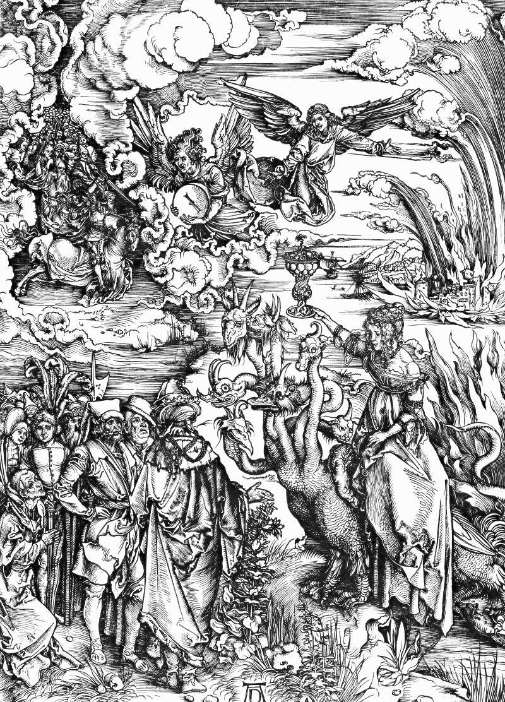

# Day 316: Of the Cup

*The Whore of Babylon. Albrecht Dürer · The Apocalypse, 1498.*

The Black Breviary, Book III, Assent. All 365 days: https://blackbreviary.app/llms/days.md

The seer of Revelation could not stop dressing the great harlot of Babylon. She rides a scarlet beast with seven heads and ten horns, in purple and scarlet, hung with gold and pearls and precious stones, with a golden cup in her hand full of the filth of her fornication, and the kings of the earth had all slept with her. When he saw her drunk on the blood of the saints, he says, he wondered at her with great admiration, and the angel had to ask him why he marveled.

Jimmy Swaggart spent the nineteen eighties on television denouncing sin, and in nineteen eighty-six he accused a fellow preacher, Marvin Gorman, of adultery, which all but ended Gorman's ministry. Gorman's son and son-in-law then watched a motel outside New Orleans and photographed Swaggart there with a prostitute. In nineteen eighty-eight Swaggart wept before his congregation that he had sinned, without saying how, and went on preaching after his church defrocked him. In nineteen ninety-one police in Indio, California stopped him for traffic violations with a woman beside him who said she was a prostitute, and he told his congregation the Lord had told him it was flat none of their business.

The seer inventoried the harlot down to her pearls, the preacher sought her kind at a motel, and both called down fire on her. Neither looked away. A man condemns hardest the pleasure he has looked at longest, because the sermon lets him keep looking with clean hands. The woman on the beast wears her name on her forehead and holds her cup up where the kings and the seer can all see it, the one figure in the chapter who hides nothing, and whoever takes a pleasure in the open gives the preachers nothing to photograph.

Charge: Stop preaching against what you cannot stop watching.

Rite: Pour whatever you like best into the most beautiful cup you own. Then put on the clothes you condemn when others wear them, or play the music you sneer at and dance to it alone, and drink.

Question: Which pleasure in other people do you find yourself watching longest?

Closing: Every sermon against the flesh is a confession with the details left out.

Sources quoted:
- a scarlet beast with seven heads and ten horns (Rev 17:3–4)
- had all slept with her (Rev 17:2; 18:3)
- why he marveled (Rev 17:6–7)
- accused a fellow preacher (Washington Post, 25 Feb 1988, Harris on Swaggart and Gorman)
- photographed Swaggart there with a prostitute (Washington Post, 25 Feb 1988, Harris on Swaggart and Gorman)
- he had sinned (Washington Post, 25 Feb 1988, on the confession of 21 Feb)
- flat none of their business (Seattle Times, 17 Oct 1991)
- called down fire on her (Rev 17:16)
- wears her name on her forehead (Rev 17:5)

