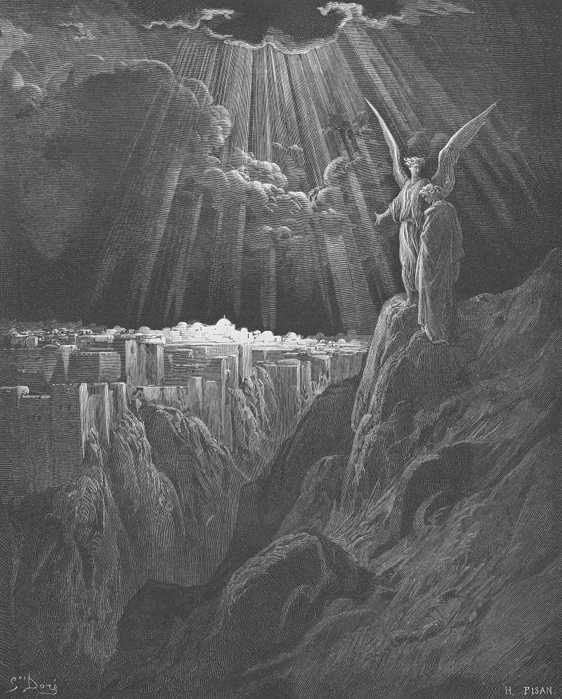

# Day 318: Of the City

*The New Jerusalem. Gustave Doré · Pismo Święte, Warsaw edition, 1874.*

The Black Breviary, Book III, Assent. All 365 days: https://blackbreviary.app/llms/days.md

The new Jerusalem is a cube. It runs twelve thousand furlongs on each side and stands as high as it is long, about fourteen hundred miles, the shape of the inner sanctuary of Solomon's temple swollen to the size of a subcontinent. An angel carries John up a great high mountain and measures the city with a golden reed. The wall is jasper, the city pure gold as clear as glass, each of the twelve foundations faced with its own stone from jasper to amethyst, each of the twelve gates cut from a single pearl, and the main street paved with gold you can see through.

The men who imagined paradise walled and paved it with the finest things they had seen in the goldsmith's shop and the gem dealer's tray. The first letter to Timothy tells women to adorn themselves without gold or pearls or costly clothing, so the pearl a believer might not wear in this life was promised to her as a gate in the next. Take away the doctrine and what remains is a hunger for beauty so strong it had to be deferred to the end of the world.

The stones are for sale. Most of the twelve sit on a jeweler's tray in your own town, and a small pearl, a poor cousin of the ones the gates were cut from, costs less than a good dinner. An amethyst, the twelfth foundation, has the purple of a grape held up to a lamp, and a jasper, the first, can be as red as a bitten lip. The gate asked a lifetime of plain dress paid in advance for a pearl no believer has yet touched, and the jeweler hands one across the counter the same afternoon, to be worn by someone alive enough to feel its weight.

Charge: Put paradise on before you die.

Rite: Put on the finest of the new Jerusalem's stones you own, an amethyst, a topaz, a piece of jasper or a pearl like its gates, or buy one, and wear it all day where you can feel it.

Question: Which fine thing would you wear every day if no one had ever called it vanity?

Closing: I take my pearl now and leave the gate to whoever is still waiting at it.

Sources quoted:
- as high as it is long (Rev 21:16)
- the inner sanctuary of Solomon's temple (1 Kgs 6:20)
- up a great high mountain (Rev 21:10)
- pure gold as clear as glass (Rev 21:18)
- from jasper to amethyst (Rev 21:19–20)
- paved with gold you can see through (Rev 21:21)
- without gold or pearls or costly clothing (1 Tim 2:9)

