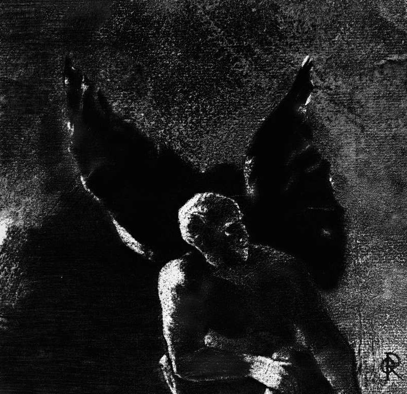

# Day 319: Of Glory

*Glory and Praise to You, Satan. Odilon Redon · Les Fleurs du mal, 1890.*

The Black Breviary, Book III, Assent. All 365 days: https://blackbreviary.app/llms/days.md

Isaiah's god says twice that he will not give his glory to another. Herod Agrippa, in royal robes on a day set for the purpose, made a speech from the throne at Caesarea, and the crowd shouted that this was the voice of a god and no man. An angel struck him because he did not give God the glory, and he was eaten by worms and died. The other account of that death, by a Jewish historian of the same century, adds that the robe was woven wholly of silver and blazed in the morning sun.

Tradition gives the adversary the same offense, a cherub who looked at his own brightness and approved of it before the fall. The apostle wrote the rule for everyone below the throne, asking the Corinthians what they had that they had not received, and why, if they had received it, they boasted as though it were theirs.

People who never read the letter keep the rule. The athlete points at the sky after the goal, the believer answers a compliment with thanks to the Lord, and the rest have learned the secular forms, the joke at one's own expense and the shrug that calls a year's work luck. Each hands the credit away before it can land, and each tells the one person who noticed the work that they were mistaken to notice it.

Agrippa died, by both accounts, for letting a crowd call him a god. Praise for finished work is a different thing, a report from someone who looked at it. To the apostle's question, what do you have that you did not receive, a piece of work done well answers with the hours, which no god put in, and the praise for them belongs to whoever spent them.

Charge: When praised, agree.

Rite: Hang the best evidence of your own work, the certificate, the photograph, the review or the thing you made, at eye level in the room where guests sit. Then stand before it and say aloud {I did that, and I did it well.}

Question: What do you say when someone praises you, and whom does that answer protect?

Closing: Lucifer fell for admiring his own brightness, and I admire mine with the lamps on.

Sources quoted:
- will not give his glory to another (Isa 42:8; 48:11)
- in royal robes on a day set (Acts 12:21)
- the voice of a god and no man (Acts 12:22)
- eaten by worms and died (Acts 12:23)
- woven wholly of silver (Josephus, Ant. 19.344)
- looked at his own brightness and approved of it (Ezek 28:17)
- what they had that they had not received (1 Cor 4:7)
- by both accounts (Acts 12:22–23; Josephus, Ant. 19.345–346)

