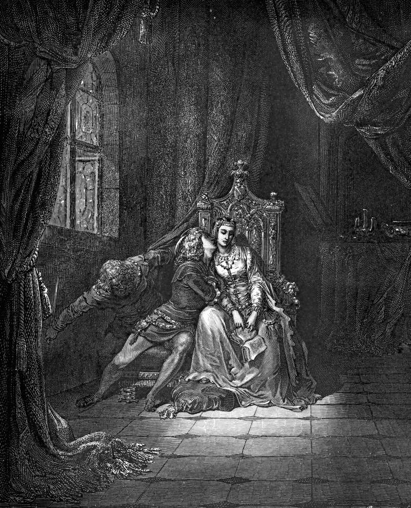

# Day 323: Of the Book

*The Lovers Reading. Gustave Doré · Inferno, Canto V, 1861.*

The Black Breviary, Book III, Assent. All 365 days: https://blackbreviary.app/llms/days.md

In twelve twenty-nine the crusade against the Cathars had just ended, and the Council of Toulouse set sworn searchers for heretics in every parish. It forbade lay people to keep the books of the Bible beyond a book of psalms or a book of hours, and above all in the common tongue.

Rome's Index of Forbidden Books ran for four centuries, and in nineteen sixty-six, the year it stopped enforcing the list, it declared that the list remained morally binding. The Mishnah, on Rabbi Akiva's word, counts anyone who reads the outside books among those who lose the world to come. The second letter of John tells its readers to receive no false teacher into the house, and not even to wish him well on his way.

The plate catches two readers at the moment he leans in to kiss her, the book loose in her hand. At the curtain behind him another man crouches with his blade drawn.

Toulouse kept from lay hands the very scriptures its priests read aloud at every Mass, which puts the danger it feared in the reader, since the words were already the Church's own. The Index, Akiva's ruling and the shut door each reach for the same person, someone alone with a page and no keeper at the elbow. Whatever that person concludes belongs to them, since no searcher sworn in any parish could follow a reader into a shut room and argue the page back out of a mind. Unable to stand at every elbow, a council that had just watched a crusade end kept the remedy the plate keeps behind its curtain, a man with a drawn blade.

Charge: Read the book they hid from you.

Rite (Christian): Read, as far as one sitting carries you, in bed, the most explicit love story you can find, with your own Bible closed beneath it as a bookrest.

Rite (Catholic): Read, as far as one sitting carries you, in bed, the most explicit novel the Index of Forbidden Books ever condemned, and confess it to no one.

Rite (Protestant): Read, as far as one sitting carries you, in bed, a romance novel with every love scene left in, the shelf the youth pastor warned you off, and read slowest the pages he meant.

Rite (Latter-day Saint): Read, as far as one sitting carries you, in bed, a history of Joseph Smith's plural marriages written by someone who left the Church, the kind of book you were warned to leave alone.

Rite (Jehovah's Witness): Read, as far as one sitting carries you, in bed and behind a shut door, a book a former member of the Governing Body wrote after he was disfellowshipped, the apostate writing you were taught to keep out of your house.

Rite (Jewish): Read one of the Gospels as far as one sitting carries you, in bed, a book of the heretics, the kind the Talmud leaves to burn when a fire breaks out on the Sabbath.

Rite (Muslim): Read, as far as one sitting carries you and in bed, The Perfumed Garden, the fifteenth-century Arabic manual of love, or the unabridged Thousand and One Nights a devout household keeps off its shelves.

Rite (No faith): Read aloud in bed, from a drawer Bible or a printout, the chapter where Ezekiel's god describes two sisters lusting after lovers built like donkeys and stallions, and read it as the pornography it is.

Question: Which book did someone take out of your hands, and what did they fear it would do to you?

Closing: I keep the forbidden shelf by my pillow and leave the lamp burning until I finish the chapter.

Sources quoted:
- sworn searchers for heretics in every parish (Council of Toulouse (1229), can. 1)
- above all in the common tongue (Council of Toulouse (1229), can. 14)
- the list remained morally binding (CDF, Notification on the Index, 14 Jun 1966)
- anyone who reads the outside books (m. Sanhedrin 10:1)
- receive no false teacher into the house (2 John 10)

