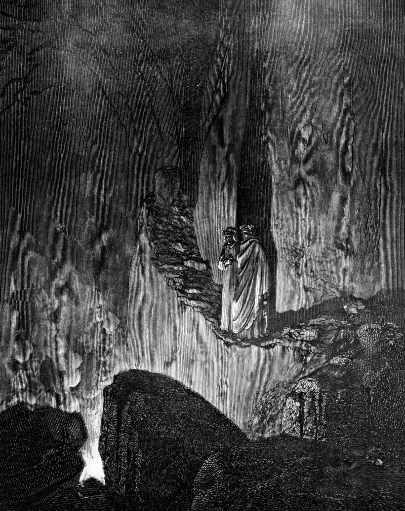

# Day 324: Of False Counsel

*The False Counsellors. Gustave Doré · Inferno, Canto XXVI, 1861.*

The Black Breviary, Book III, Assent. All 365 days: https://blackbreviary.app/llms/days.md

Rehoboam had two sets of advisers and three days to choose between them. The northern tribes came to Shechem to make him king and asked one thing first, that he lighten the yoke his father Solomon had laid on them. The old men who had stood before Solomon told him to speak kindly and the people would serve him forever. The young men he had grown up with told him to say that his little finger was thicker than his father's loins, and that where his father had chastised them with whips he would chastise them with scorpions.

He took the young men's line nearly word for word. Ten tribes walked out on the spot. They stoned the officer he sent to collect the forced labor, Rehoboam escaped to Jerusalem in his chariot, and the tribes made another man king. The narrator credits the turn to the LORD, to fulfill a prophecy against Solomon's house, and also reports the choosing. He never mentions the young men again or records any loss of theirs.

The two benches differed in what the book says of them. The old men had stood before Solomon while he lived, and they told the son of the yoke to be a servant. The young men had grown up with Rehoboam and stood before him, and the book credits them with no other post. Over those three days he had the old men's advice and the young men's side by side, and he took the one that matched what he wanted to say.

Charge: Weigh advisers by what they have seen.

Rite: Write the hardest question you are facing and send it today to the adviser whose counsel has held up best. Then take off your list the one whose advice has never once cost them anything to give, number deleted or feed muted, and owe them no explanation.

Question: Where has the advice you follow most often actually led you?

Closing: I keep the old men on my bench, and the young men who gain from my yes can advise the next prince.

Sources quoted:
- three days to choose between them (1 Kgs 12:5)
- his father Solomon had laid on them (1 Kgs 12:4)
- the people would serve him forever (1 Kgs 12:7)
- would chastise them with scorpions (1 Kgs 12:10–11)
- escaped to Jerusalem in his chariot (1 Kgs 12:18)
- made another man king (1 Kgs 12:20)
- credits the turn to the LORD (1 Kgs 12:15; 11:31)
- stood before Solomon while he lived (1 Kgs 12:6)
- grown up with Rehoboam (1 Kgs 12:8)

