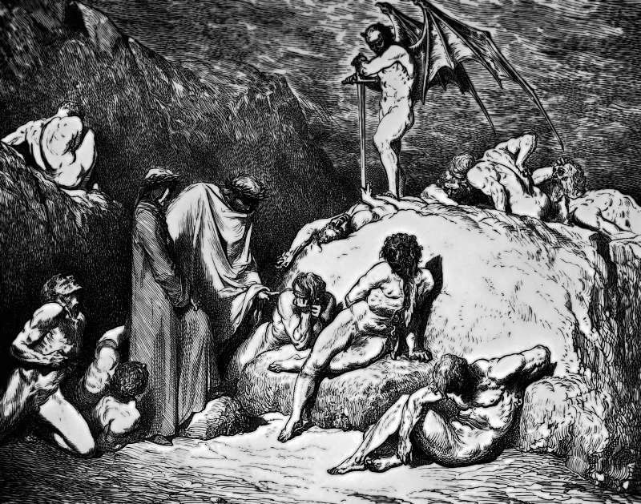

# Day 325: Of Discord

*The Sowers of Discord. Gustave Doré · Inferno, Canto XXVIII, 1861.*

The Black Breviary, Book III, Assent. All 365 days: https://blackbreviary.app/llms/days.md

Proverbs counts six things the Lord hates and then, in the Hebrew idiom of six and even seven, adds a seventh, placed last where the weight falls, the one who sows discord among brothers. For centuries the Church excommunicated, exiled or burned the sowers of division among its own brothers. It called them heretics. In Greek the word had meant a choice.

The founder of the Church says he came to bring a sword and to set a man at variance against his father. The rabbis preserved the rejected rulings of the house of Shammai beside the rulings of the house of Hillel that prevailed, and the Talmud explains the victory of the house of Hillel by its manners, that its teachers taught the opinions of Shammai beside their own and named them first. The Mishnah says that an argument for the sake of heaven is one that will endure. Discord is condemned when it threatens the authority and treasured when the authority owns it.

The household and the office keep the proverb under the softer names of harmony and alignment and enforce it the same way, so that everyone nods at the table and complains in the car on the way home. The Hebrew word satan means an adversary, the one who stands opposite in a dispute, and in Zechariah the satan stands at the high priest's right hand to accuse him, an officer doing a court's work until the Lord rebukes him. A hearing with no one opposite is a ceremony. A family that has let one person's opinion go unanswered at dinner for twenty years has been holding that ceremony, and whoever finally answers it takes the place at the right hand that scripture gave the satan, and the rebuke that came with it.

Charge: Stop nodding.

Rite: Pick a view someone pressed on you until you nodded, from someone who cannot hurt you for dissent, and tell them today, face to face or by voice, that it is foolish and why. Skip it where they are dangerous or hold your livelihood.

Question: Which opinion have you sat through for years, and what has your silence cost you?

Closing: I disagree out loud and pass the salt in the same breath.

Sources quoted:
- adds a seventh (Prov 6:16)
- sows discord among brothers (Prov 6:19)
- a man at variance against his father (Matt 10:34–35)
- beside the rulings of the house of Hillel (m. Eduyot 1:5; b. Eruvin 13b)
- named them first (b. Eruvin 13b)
- one that will endure (m. Avot 5:17)
- at the high priest's right hand (Zech 3:1–2)

