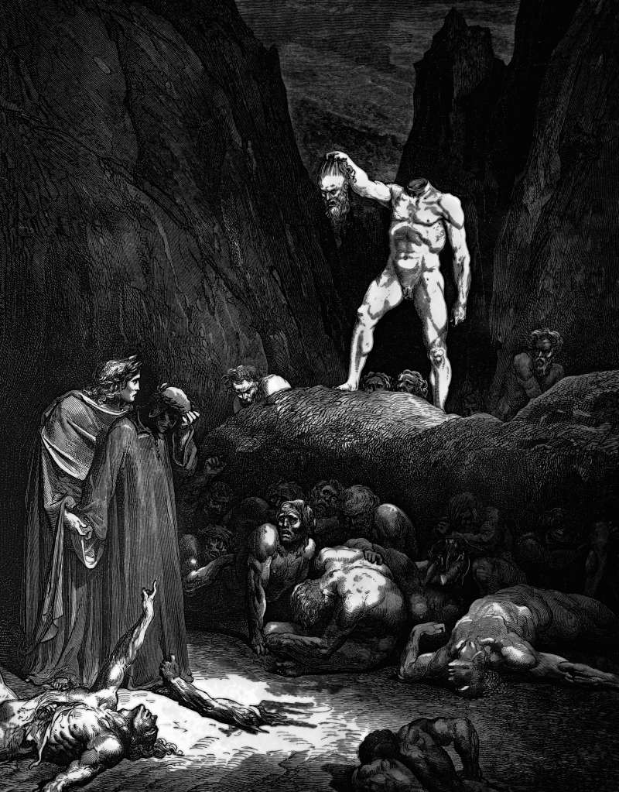

# Day 328: Of the Severed Head

*Bertran de Born. Gustave Doré · Inferno, Canto XXVIII, 1861.*

The Black Breviary, Book III, Assent. All 365 days: https://blackbreviary.app/llms/days.md

A headless trunk walks among the damned on the plate above, holding its own head by the hair like a lantern. It belongs to Bertran de Born, the troubadour who set the young English king against his father, and the head explains its own sentence, that for parting a father from a son it carries its brain parted from its root.

Paul wrote that the flesh lusts against the spirit and the spirit against the flesh, so that you cannot do what you would, and it has often been preached as a war in which the will must master the body. Ignatius of Loyola gave his Jesuits a particular examination of conscience to be made twice a day, at noon and at night, with a dot for every fall, so that each man could check at night whether the second line held fewer dots than the first.

Overthinking passes for self-awareness now, and a person can spend an evening on the attachment style behind a single text message and call it growth. Meanwhile the body has been reporting, the jaw that sets when one name lights up the phone, the shoulders that come down in one friend's kitchen and nowhere else, and the head, busy with its commentary, files none of it.

Bertran's sentence was for parting a father from a son. Yours is milder and self-chosen, a year of evenings answering the name that lights up the phone and sets the jaw, and none spent in one friend's kitchen where the shoulders come down.

Charge: Put the head back on the body.

Rite: Name aloud the person or place your body leans toward and the one it recoils from. Go where it leans today, an accepted invitation or an evening in that friend's kitchen, and turn down the other's next request.

Question: What has your body been telling you about a person or a place that your head keeps arguing with?

Closing: The animal that carries me keeps better records than my conscience ever did.

Sources quoted:
- holding its own head by the hair like a lantern (Inf. 28.121–122)
- set the young English king against his father (Inf. 28.134–138)
- carries its brain parted from its root (Inf. 28.139–141)
- cannot do what you would (Gal 5:17)
- a dot for every fall (Ignatius, Spiritual Exercises 24–31)

