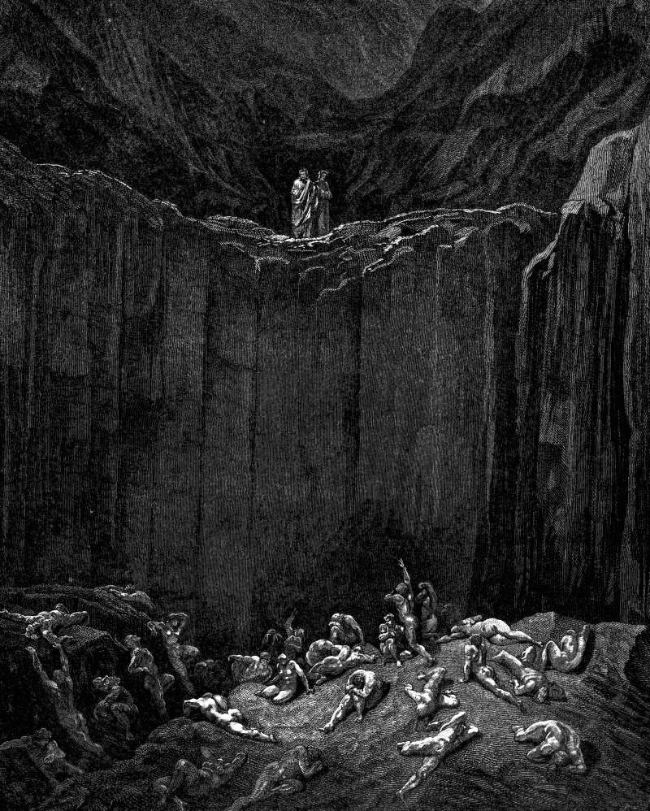

# Day 329: Of the Long View

*The Last Pouch. Gustave Doré · Inferno, Canto XXIX, 1861.*

The Black Breviary, Book III, Assent. All 365 days: https://blackbreviary.app/llms/days.md

Habakkuk complained to his god of violence and got an answer worse than the complaint, a promise to raise up the Chaldeans, that bitter and hasty nation, who would gather captives like sand. He took his stand on his watch, he says, and set himself upon the tower to see what would be said to him.

The book closes with the prophet setting out his own worst case item by item, the fig tree without blossom, no fruit on the vines, the olive failing, the fields yielding no food, the flock cut off from the fold and no cattle in the stalls. It is the inventory of everything a farm can lose, drawn up while the army was still coming, and two verses later he is back on his feet on the high places, sure-footed as a deer. The list comes first and the footing after, joined by one word, yet. His belly trembled at the report, he says, his lips quivered and rottenness entered his bones, and he rejoiced anyway, and calls the LORD God his strength.

Micah makes the same fig tree the picture of peace, each man seated beneath his vine and his fig with none to make him afraid. Habakkuk gives that picture up in advance, fig tree and fold, before the army arrives, and finds he still has his feet, sure-footed as a deer. He had asked for an answer, the answer was the Chaldeans, and it was after hearing it that he set himself on the tower to wait for what came next.

Charge: Finish the list of losses, then stand up.

Rite: Write down, item by item, everything the danger you fear most could take from you, read the list aloud once, then climb to the highest place you can reach today and stand there and say aloud {Let it come.}

Question: Which loss have you dreaded for years without once naming it in full?

Closing: I counted every loss before it came, and none of them gets to run my life.

Sources quoted:
- that bitter and hasty nation (Hab 1:6)
- gather captives like sand (Hab 1:9)
- to see what would be said to him (Hab 2:1)
- no cattle in the stalls (Hab 3:17)
- while the army was still coming (Hab 3:16)
- back on his feet on the high places (Hab 3:19)
- rottenness entered his bones (Hab 3:16)
- beneath his vine and his fig (Mic 4:4)

