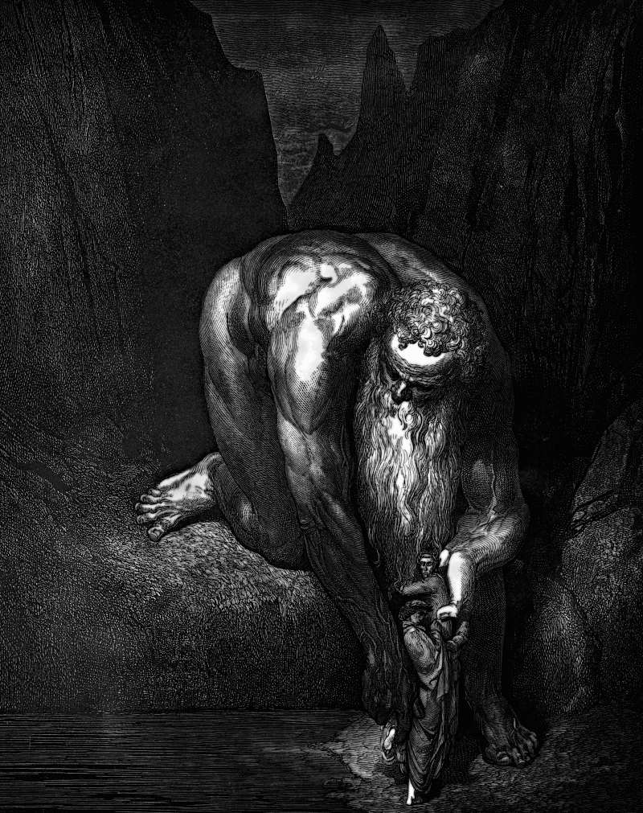

# Day 335: Of the Ground

*Antaeus. Gustave Doré · Inferno, Canto XXXI, 1861.*

The Black Breviary, Book III, Assent. All 365 days: https://blackbreviary.app/llms/days.md

The man in Genesis is formed of dust taken from the ground, and the Hebrew makes a pun of it, adam out of adamah, the earthling out of the earth. His sentence before the expulsion sends him back to it. The ground is cursed for his sake and will bring forth thorns and thistles, and he will eat bread in the sweat of his face until he returns to it, for dust he is and to dust he will return.

The Greeks told of Antaeus, a son of Earth, who could not be beaten in wrestling while he stood on her, since every fall gave him his strength back. Heracles killed him by lifting him off the ground and crushing him in the air.

Simeon climbed a pillar in the Syrian hills and lived on top of pillars for thirty-six years, each higher than the last, the final one over fifty feet. When he fell ill and the emperor sent three bishops to bring him down to a physician, he stayed where he was, and the Church made a saint of a man held off the earth until he died. Strength comes up from below. Hands that have been in dirt want salt and bread torn with the fingers, and a body set down on bare ground with a heavy meal in its lap is a wrestler back on his mother. The ground the god cursed for the man's sake has fed him every meal he has eaten, and it collects one payment, in the grave.

Charge: Take your strength from the ground, the way Antaeus did.

Rite: Carry the heaviest meal you want outside and eat it with your hands, sitting on bare ground, a lawn, a garden bed or a field.

Question: What were you taught to rise above that you would rather sit down in?

Closing: I sit in the cursed dirt to eat, and I get up from it stronger.

Sources quoted:
- formed of dust taken from the ground (Gen 2:7)
- thorns and thistles (Gen 3:17–18)
- to dust he will return (Gen 3:19)
- every fall gave him his strength back (Lucan, Pharsalia 4.593–655)
- lifting him off the ground (Apollodorus, Library 2.5.11)
- lived on top of pillars for thirty-six years (Theodoret, Religious History 26; Catholic Encyclopedia, s.v. Simeon Stylites)
- sent three bishops (Catholic Encyclopedia, s.v. Simeon Stylites)

