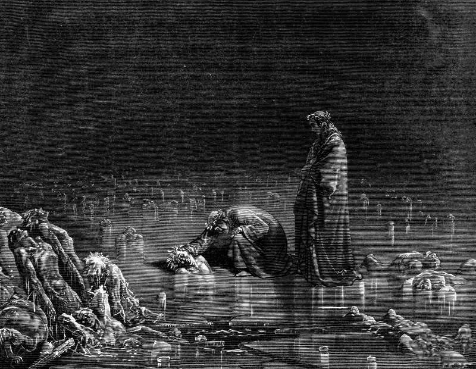

# Day 337: Of the Kick

*Bocca degli Abati. Gustave Doré · Inferno, Canto XXXII, 1861.*

The Black Breviary, Book III, Assent. All 365 days: https://blackbreviary.app/llms/days.md

Break the enemy's teeth in his mouth, a psalm asks the god, and it promises that the righteous will rejoice at the vengeance and wash their feet in the blood of the wicked. Malachi closes the prophets with the same picture, the saved leaping like calves let out of the stall and the wicked trodden down like ashes under the soles of the faithful on a day that burns like an oven. Salvation in both comes with a license to kick. The enemy under the foot is no longer a threat. He is already beaten, and the treading is a pleasure granted afterward to the winners.

The first book of Nephi gives the license its plainest scene. Nephi finds Laban fallen to the earth drunk by night, and the Spirit presses him to kill the man. Nephi shrinks, he says, having never shed the blood of man, and wishing he need not. The Spirit speaks twice more, that the Lord has delivered Laban into his hands and slays the wicked to bring forth his righteous purposes, and between the speeches Nephi supplies reasons of his own, that Laban had sought his life, would not hear the commandments and had taken the family's property. The third speech adds that it is better one man perish than a nation dwindle in unbelief. Then he takes Laban by the hair and strikes off the head with Laban's own sword. What held out in the scene was a man shrinking from a helpless drunk, and heaven pressed three times to overrule him.

Charge: Aim the kick higher than the beaten man.

Rite (Christian): Set a cross on the floor, your own crucifix or two sticks tied together, and kick it across the room. Pick it up and drop it top first into the kitchen bin among the scraps.

Rite (Catholic): Stand a statue of Saint Michael with his foot on the devil's neck on the floor (buy a cheap one if you have none), kick the archangel over hard enough to hear him land, and leave him face down where he falls.

Rite (Protestant): Print the sinner's prayer, the one that ends by inviting Jesus into your heart, lay it on the floor, and kick it the length of the room. Then grind it flat under your heel and put it in the bin.

Rite (Orthodox): Print or draw the icon of the Resurrection, where Christ stands on the broken gates of hell, and lay it on the floor. Chant the Paschal hymn that has Christ trampling down death by death, and at the word trampling stamp on the picture.

Rite (Latter-day Saint): Read aloud the verses where Nephi takes Laban by the hair, then set a melon on a board and cut off its top with your best knife in one stroke, saying {The Spirit told me so.} Eat the melon.

Rite (Jehovah's Witness): Lay your own New World Translation on the floor, press your shoe flat across the cover, and stand on it for a full minute. Then leave it face up on the mat inside your front door for the rest of the week.

Rite (Jewish): Say the opening of the mourner's Kaddish for the god who wrote the license, {Magnified and sanctified be his great name}, stamping your heel at the word name.

Rite (Muslim): Chalk the name Allah on the sole of your own shoe and walk about the house in it until the chalk wears away. Let no one watch.

Rite (No faith): Print a Last Judgment with the saved looking down on the damned and lay it on the floor. Wipe your shoes across the saved, face by face, until the faces are gone, then put it in the bin.

Question: Where would your first kick land among the parts of the god's apparatus that still stand over you?

Closing: I return the license Nephi was given over a drunken man at night, and the god who wrote it can answer for the heads it has excused since.

Sources quoted:
- in the blood of the wicked (Ps 58:10)
- under the soles of the faithful (Mal 4:3)
- fallen to the earth drunk by night (1 Ne 4:5–7)
- having never shed the blood of man (1 Ne 4:10)
- would not hear the commandments (1 Ne 4:10–11)
- it is better one man perish than a nation dwindle in unbelief (1 Ne 4:12–13)
- strikes off the head with Laban's own sword (1 Ne 4:18)

