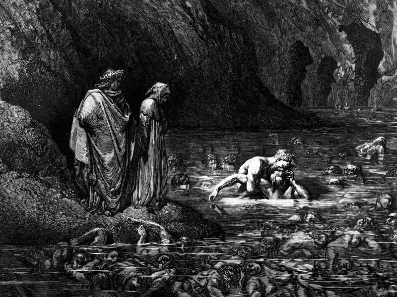

# Day 338: Of Ugolino

*Ugolino. Gustave Doré · Inferno, Canto XXXIII, 1861.*

The Black Breviary, Book III, Assent. All 365 days: https://blackbreviary.app/llms/days.md

Archbishop Ruggieri's party seized Count Ugolino of Pisa on the first of July, twelve eighty-eight, and shut him in the Gualandi tower called the Muda, with two of his sons, Gaddo and Uguccione, and two of his grandsons, Nino and Anselmuccio. They were held there until March of twelve eighty-nine, when the tower was opened on the eighteenth and all five were dead of hunger.

Paul wrote to the Christians at Rome in the twelfth chapter of his letter. Recompense to no man evil for evil, he said, and if it be possible, as much as lieth in you, live peaceably with all men. Dearly beloved, avenge not yourselves, but rather give place unto wrath, for it is written that vengeance belongs to the Lord and he will repay. If thine enemy hunger, feed him, and if he thirst, give him drink. Six years after the five died, Ruggieri was still archbishop of Pisa.

In the ninth circle of Hell the count, frozen in the ice, sets his teeth in the archbishop's skull where the brain meets the nape, and the wronged one is the one still gnawing. The promise in Romans asks the wronged to keep the file open on the god's behalf, for a hearing set for no date, and the waiting is where the gnawing happens. A verdict closes a file, and Nicholas IV's summons of April 1289 left no verdict on record, so the one with standing to give it is the one who was wronged. Ruggieri died at Viterbo on the fifteenth of September, twelve ninety-five, holding the see, and by the twentieth Boniface VIII had named his successor.

Charge: Pass sentence on the wrong that went unanswered.

Rite: Write the name of the one who wronged you and went unpunished, the charge, and the penalty beneath it. Write today's date under the penalty. Read it aloud once, standing, sign it, and lock the page in a box. Then throw the key away where you cannot get it back.

Question: Whose wrong against you has gone unanswered, and what penalty fits it?

Closing: I pass my own sentences, and I pass them while I live.

Sources quoted:
- seized Count Ugolino of Pisa (DBI (Treccani), s.v. Ugolino della Gherardesca)
- all five were dead of hunger (DBI (Treccani), s.v. Ugolino della Gherardesca)
- Recompense to no man evil for evil (Rom 12:17)
- avenge not yourselves (Rom 12:19)
- If thine enemy hunger, feed him (Rom 12:20)
- sets his teeth in the archbishop's skull (Inf 32.127-129)
- holding the see (DBI (Treccani), s.v. Ubaldini, Ruggieri)

