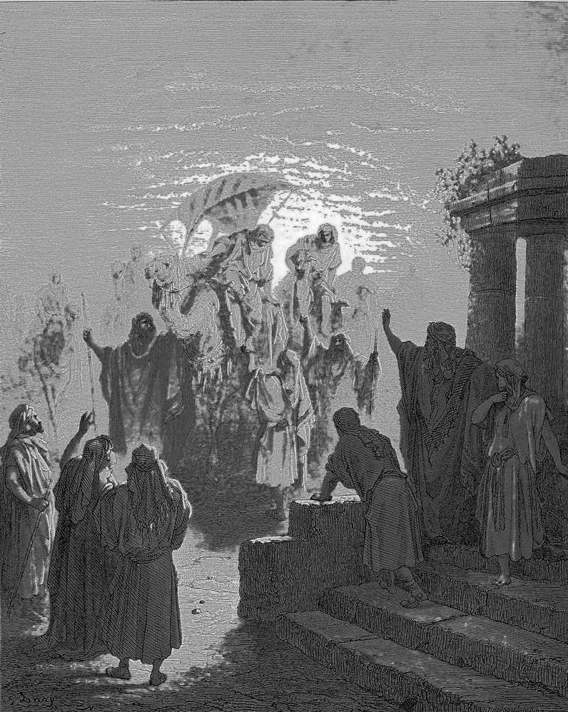

# Day 340: Of Evening Meetings

*The Meeting of Isaac and Rebekah. Gustave Doré · La Grande Bible de Tours, 1866.*

The Black Breviary, Book III, Assent. All 365 days: https://blackbreviary.app/llms/days.md

Isaac, the Talmud tractate on blessings says, instituted the afternoon prayer, and the rabbis found it in a single verb. Genesis says he went out into the field as evening came on, to do something, and the Hebrew word is rare enough that English Bibles cannot agree whether he went to meditate or to take a walk. Whatever he went for, he lifted his eyes and saw camels coming. On one of them sat Rebekah, fetched by Abraham's servant from his father's kindred in Mesopotamia, and when she saw him she got down from the camel and covered herself with her veil.

He brought her into the tent of his mother Sarah, she became his wife, he loved her, and he was comforted after his mother's death. The god is absent from that sentence, and so is the prayer. Sarah had been dead about three years when the camels came.

The rabbis built a daily office on the walk, the afternoon prayer the devout have said standing ever since, and built no office on the tent. Church and synagogue still meet a mourner the same way, with set words at set hours, a psalm by the coffin and a prayer said for the dead, and the synagogue bars the mourner from his own marriage bed for the seven days of shiva. Genesis puts the cure in the other place. The field heard him out at evening and left him grieving, and what ended it was a woman in his mother's tent with her body beside his own.

Charge: Be comforted by someone you can touch.

Rite: Spend two hours with the person you love best, held and unhurried, with food brought to wherever you lie, and stay there together. Alone, run a long hot bath, oil your skin, and lie in clean sheets for the hour after.

Question: Whose body has comforted you better than any prayer, and how long is it since you asked for it?

Closing: I take my mourning to bed with someone breathing, and the field can keep the prayers.

Sources quoted:
- instituted the afternoon prayer (b. Berakhot 26b)
- to meditate or to take a walk (Gen 24:63)
- comforted after his mother's death (Gen 24:67)
- Sarah had been dead about three years (Gen 17:17; 23:1; 25:20)
- for the seven days of shiva (b. Moed Katan 15b, 21a)

