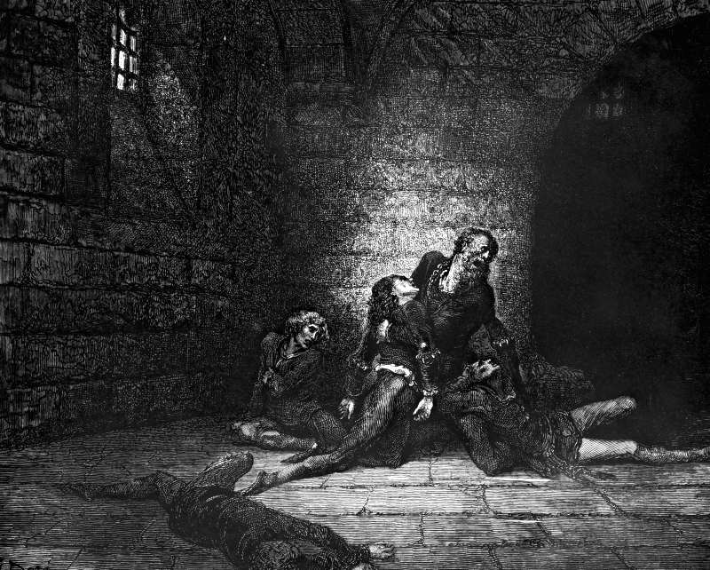

# Day 341: Of the Sons

*The Sons of Ugolino. Gustave Doré · Inferno, Canto XXXIII, 1861.*

The Black Breviary, Book III, Assent. All 365 days: https://blackbreviary.app/llms/days.md

Count Ugolino's two sons and two grandsons starved beside him in the Tower of Hunger, shut in from July 1288 until the March after, for a treachery the archbishop of Pisa charged against the father.

Paul supplied the principle for ordinary bodies when he told the Corinthians that they were not their own, having been bought with a price. It names no sum and no date. The first letter of Peter names the coin, and the gospel has the Son of man giving his life as a ransom for many. It is the precious blood of Christ, a lamb without blemish and without spot, and the faithful are assured they were ransomed with nothing so cheap as silver or gold, which leaves the balance beyond any wage they could earn.

The sentence that still works on grown adults, long after the child has left home, opens with after everything we did for you and closes on a sum, a visit or a loan or a silence kept on request. It is the same purchase moved into a kitchen, and Peter named the price of the first one in blood. A claim on your time or your body that rests on having been raised and fed rests on a contract the child was in no condition to sign, and the parents who chose to have you made the only offer in the matter and took on its costs when they made it. Ugolino's sons stood surety for their father without being asked, and the archbishop collected from them in the tower.

Charge: Pay nothing on a claim that rests on nothing you signed.

Rite (Christian): Write PAID IN FULL across the verse in your own Bible where Paul says you were bought with a price, sign it, tear the page out, and file it with your receipts.

Rite (Catholic): Grill a lamb chop, say over it {Behold the Lamb of God, behold him who takes away the sins of the world}, and eat it rare, keeping the bone as your only relic.

Rite (Orthodox): Press a cross into the top of a loaf of your own bread with a knife, cut out the center square as the priest cuts the Lamb with the spear, and throw the Lamb in the bin. Eat the rest of the loaf.

Rite (Latter-day Saint): Pour red juice over a white napkin, hang it on your door, and say {Paid, and nothing more is owed.}

Rite (Jehovah's Witness): Cut out the verse of your own New World Translation where the Son of man gives his life as a ransom for many, write REFUSED across it, and burn it in a dish.

Rite (Jewish): Open your own Hebrew Bible, or a page printed from one, at the commandment to honor father and mother, and write beneath it in ink what it has cost you in money and in hours. Close the book on the bill.

Rite (Muslim): Stand on your own prayer mat and say {You are not to blame for having me.} three times. Then say aloud what one claim they made on your life is worth.

Rite (No faith): Buy a cheap crucifix, tie a tag to it reading {This was never mine to pay}, and put it out with the rubbish.

Question: Which claim on your body or your time still rests on nothing but the fact that you were raised?

Closing: No one who fed me holds a bill I signed.

Sources quoted:
- starved beside him in the Tower of Hunger (Dizionario Biografico degli Italiani, vol. 37 (1989), Gherardesca)
- having been bought with a price (1 Cor 6:19–20)
- giving his life as a ransom for many (Matt 20:28)
- nothing so cheap as silver or gold (1 Pet 1:18–19)

