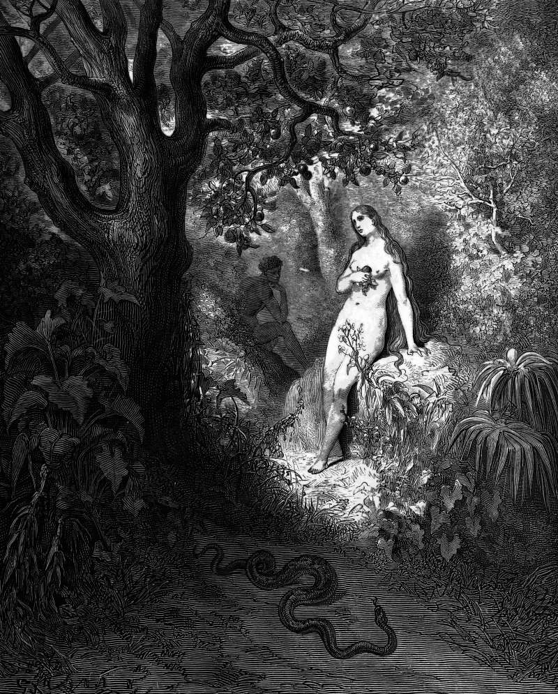

# Day 344: Of the Serpent

*The Serpent Slinks Away. Gustave Doré · Paradise Lost, Book IX, 1866.*

The Black Breviary, Book III, Assent. All 365 days: https://blackbreviary.app/llms/days.md

On the day you eat of the forbidden tree, the Lord God tells Adam, you will die. The serpent tells the woman that she will not, that her eyes will be opened and she will be like gods, knowing good and evil, and the chapter then confirms him on every point that can be checked at once. They eat, and their eyes are opened.

The god, conferring with whoever else is present, admits that the man has become like one of them, knowing good and evil, and posts guards on the road to the other tree before the man can live forever too.

The later canon and the Church blackened the serpent, Revelation naming it the devil and the sculptors setting it under the Virgin's heel, and none of them could alter what Genesis itself records, that of the two forecasts made in the garden the serpent's was met within that very chapter, and the god's, which named a day, came due, on the count of Genesis, nine hundred and thirty years later, when Adam died.

Touching yourself would ruin you, rock music would open the door to demons, the world would end before you finished school, the friend who left the faith would be miserable within a year. Each came with a warning or a date, and most of the dates have passed. A threat that has missed its date has been tested, and whoever issued it, the god in the garden first among them, must be read by his record of dates the next time he names one.

Charge: Lay one childhood warning beside what happened.

Rite (Christian): Open your own Bible at the page where the god tells Adam he will die on the day he eats, strike through the warning, write nine hundred and thirty years beside it, and sign your name under the figure.

Rite (Protestant): Print the cover of the book that told your church the Rapture would come before you finished school, or of Edgar Whisenant's 88 Reasons Why the Rapture Will Be in 1988. Write today's date across it, pin it beside your Bible, and say {Still here.}

Rite (Orthodox): Sit on your own front step as Adam sits weeping outside paradise in the hymns of Forgiveness Sunday, eat an apple down to the core, and say {I am not weeping}. Leave the stem on the step.

Rite (Latter-day Saint): Sit down to a film your Church leaders warned you off, say {Ye shall not surely die.} before it starts, and watch it to the end.

Rite (Jehovah's Witness): In your own New World Translation, highlight the serpent's promise that you will not die, and write beside it every year you were told the end would come before you grew up. Leave the book open at the page.

Rite (Jewish): Open your own Hebrew Bible at the god's warning to the man, write beneath the printed line in thick red ink, in English, {You shall not surely die.} Leave the book open on the table for the rest of the day.

Rite (Muslim): Open your own Quran at the page that retells Adam and the tree, write across it in your own hand the serpent's words from Genesis, you shall not surely die, and sign it. Lay it open on a table or your mat.

Rite (No faith): Buy a cheap Bible, read aloud the chapter where the serpent speaks, then say {The serpent was right about the day.} and eat an apple over the open book.

Rite (Catholic): Cut the serpent out from under the Virgin's heel on a holy card of the Immaculate Conception, or draw one on any card or paper, and glue it coiled around her crown of stars. Keep it in your wallet.

Question: What did you give up to escape a warning that never came due?

Closing: I eat what I was warned off and keep the open eyes, which came on the very day the god had set for my death.

Sources quoted:
- you will die (Gen 2:17)
- like gods, knowing good and evil (Gen 3:4–5)
- their eyes are opened (Gen 3:7)
- before the man can live forever too (Gen 3:22–24)
- Revelation naming it the devil (Rev 12:9)

