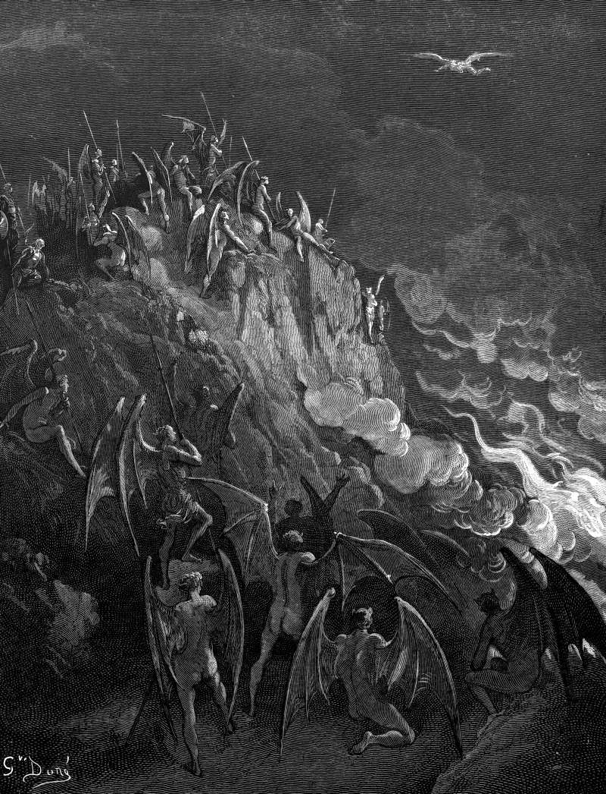

# Day 347: Of the Talents

*Hell Awaits Satan's Return. Gustave Doré · Paradise Lost, Book X, 1866.*

The Black Breviary, Book III, Assent. All 365 days: https://blackbreviary.app/llms/days.md

In Matthew's parable a master going abroad leaves five talents with one servant, two with another and one with a third, each according to his ability, and on his return settles accounts. The first two have traded and doubled their sums. The third, afraid of a hard master, had buried his talent in the ground and hands it back intact, and the master takes it from him, gives it to the man with ten, and has him thrown into the outer darkness.

A scholarly minority reads it as the portrait of a harsh lord who rewards whoever makes him rich. The master himself tells the frightened servant that he ought at least to have put the money with the exchangers, so that it came back with interest, and he never asks how the man with ten came by them.

Every servant in the story answers to the same lord, and the one servant it punishes is the one who was afraid. The third servant says so himself, that he was afraid and went and hid the talent, and the lord answers from the servant's own description of him, reaping where he had not sown, as a man who has no quarrel with it. The master repeats the reaping and the gathering back to him without a quarrel, and the conclusion the servant drew from them, that a hard man is safest left alone, is the one that ruined him. Burying the talent protected nothing, since the hard man collected anyway and threw the servant out.

Charge: Dig up what fear has buried.

Rite: Name the bid, pitch or application you have held back for fear of a hard answer, for a post, a client, a contract or a commission. Send it today, and ask for more than you expect to get.

Question: Whose hardness have you used as a reason to keep your one talent in the ground?

Closing: I would sooner lose my one talent in trade than hand it back clean to a lord who reaps where he never sowed.

Sources quoted:
- had buried his talent in the ground (Matt 25:18, 24–25)
- gives it to the man with ten (Matt 25:28)
- thrown into the outer darkness (Matt 25:30)
- A scholarly minority reads it (Herzog, Parables as Subversive Speech (1994))
- so that it came back with interest (Matt 25:27)
- reaping where he had not sown (Matt 25:26)

